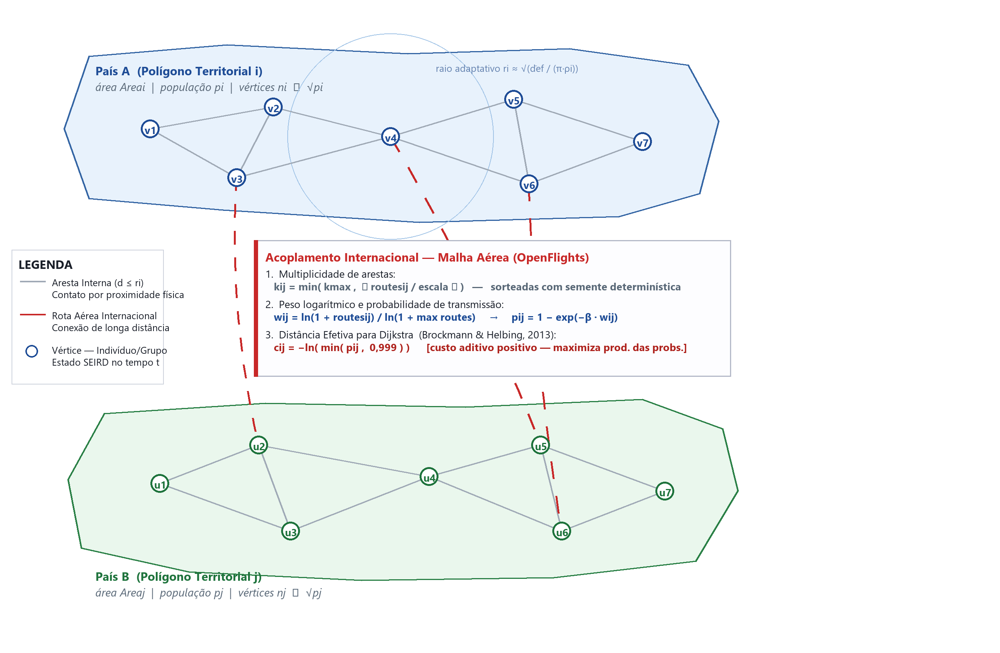
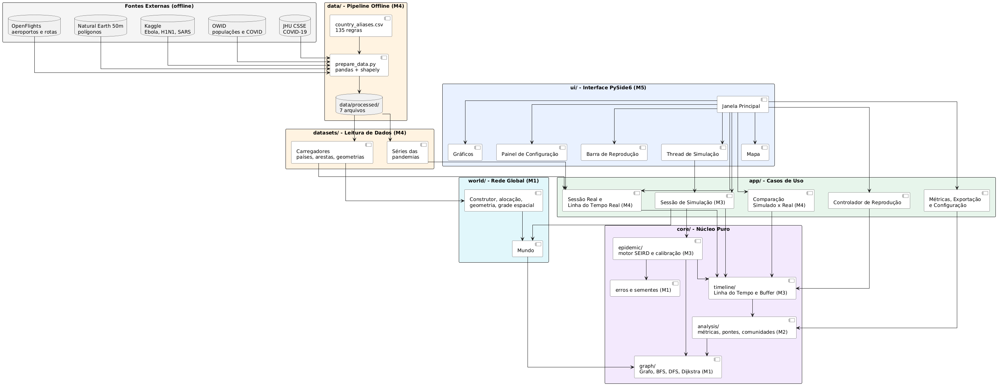
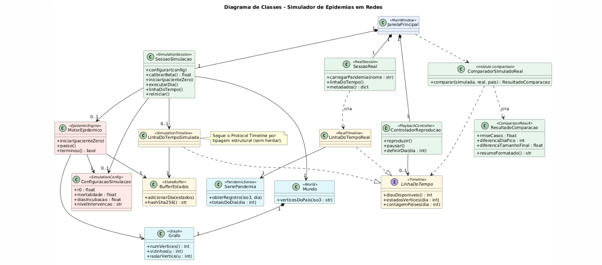

# Simulador de Epidemias em Redes


Aplicação desktop em Python para **simulação estocástica de epidemias em grafos multiescala** e **reprodução visual de pandemias históricas**, desenvolvida como Trabalho Prático da disciplina de **Teoria dos Grafos (Tema 7)** na Pontifícia Universidade Católica de Minas Gerais (PUC Minas).

O sistema modela a população mundial como um único grafo ponderado e não direcionado ($N = 8.000$ vértices distribuídos entre $229$ países), integrando difusão local por proximidade geométrica e disseminação internacional via malha aérea real (*OpenFlights*). Toda a estrutura de grafos e os algoritmos analíticos foram **implementados do zero pela equipe**, sem bibliotecas externas de grafos no código de produção.

> [!IMPORTANT]
> ### Entregáveis e Documentação do Trabalho
>
> | Entregável | Acesso |
> |---|---|
> | **Artigo Científico (SBC / LaTeX)** | [docs/latex-article/main.pdf](docs/latex-article/main.pdf) |
> | **Planejamento, Modelagem e Diagramas** | [docs/planning-doc/planejamento_e_modelagem_simulador_epidemias.md](docs/planning-doc/planejamento_e_modelagem_simulador_epidemias.md) |
> | **Slides da Apresentação** | [PDF no repositório](docs/presentation/Apresentacao-Simulador-Epidemia.pdf) · [Visualizar no Canva](https://www.canva.com/design/DAHbju7hb8g/jVGAW7_OEiGi92lMJdjmcA/edit) |
> | **Vídeo de Apresentação do Sistema** | [Assistir no Google Drive](https://drive.google.com/drive/folders/1TwYaPEytM0kT66rssrmrflYYrIWqJTVG?usp=drive_link) |

---

## Principais Funcionalidades

- **Simulação Epidemiológica Estocástica (SEIRD):** parametrização prévia de $R_0$ (com calibração automática de $\beta$ por bisseção), taxa de saída ($\gamma$), mortalidade, período de incubação, paciente zero e intervenções automáticas (isolamento por *bitmask* em $O(1)$ e vacinação).
- **Reprodução de Pandemias Reais:** visualização diária no mesmo grafo global de quatro surtos históricos — **COVID-19**, **Ebola (2014–2016)**, **H1N1 (2009)** e **SARS (2003)** — a partir de datasets públicos pré-processados.
- **Mapa-Múndi Interativo em Duas Camadas:** renderização de polígonos de países e vértices individuais sob demanda de zoom (com histerese), acompanhada de player de linha do tempo e curvas epidêmicas em tempo real.
- **Análise Estrutural em Grafos:** cálculo assíncrono de componentes conexos, caminhos mínimos de contágio (Dijkstra sobre distância efetiva), pontes e pontos de articulação (Tarjan), coeficiente de agrupamento, centralidade de intermediação (Brandes) e detecção de comunidades (Label Propagation).
- **Comparação Empírica e Exportação:** alinhamento pelo Dia 0 entre simulações e séries reais (EQM, diferença de dia de pico e tamanho final), além de salvamento/carregamento de cenários em JSON e exportação de dados e gráficos.

<p align="center">
  
  &nbsp;
  
</p>

---

## Stack Tecnológica

| Categoria | Tecnologias |
|---|---|
| **Linguagem** | Python 3.12 (`>=3.12,<3.13`) |
| **Interface Gráfica e Renderização** | PySide6 (`QPainter` em lote para o mapa) e `pyqtgraph` (curvas em tempo real) |
| **Cálculo Numérico** | NumPy |
| **Núcleo de Grafos** | Implementação própria em Python puro (sem `NetworkX`/`igraph` em `src/`) |
| **Testes, Qualidade e Build** | `pytest`, `ruff` (com regra `TID251` barrando `networkx` em `src/`) e `PyInstaller` |
| **Benchmarks** | `NetworkX` (restrito exclusivamente à pasta `benchmarks/`) |
| **Fontes de Dados (pré-processadas)** | JHU CSSE / OMS (Kaggle), Our World in Data (OWID), OpenFlights e Natural Earth (50m) |

---

## Modelagem do Problema e Arquitetura

### Grafo Global Multiescala

A propagação de uma doença em escala global combina dois regimes de contato: **difusão local** dentro de cada país e **transporte de longa distância** via malha aérea. O simulador unifica ambos em um grafo ponderado e não direcionado $G = (V, E)$:

1. **Alocação de vértices por população:** os $8.000$ vértices são distribuídos entre $229$ países segundo uma lei sublinear $n_i \propto (p_i)^{0.5}$ com piso mínimo $n_{\min} = 12$, garantindo representatividade territorial sem concentrar toda a rede em poucos países.
2. **Conexões internas (Grade Espacial 2D):** os vértices são sorteados dentro do polígono geográfico de cada país (*Natural Earth 50m*) e conectados por raio adaptativo à densidade local usando uma grade espacial 2D, reduzindo a construção de $O(n_i^2)$ para $O(n_i + E_i)$.
3. **Arestas internacionais e Distância Efetiva:** pares de países conectados no *OpenFlights* recebem arestas com peso logarítmico $w_{ij}$ e probabilidade de contágio $p_{ij} = 1 - \exp(-\beta \cdot w_{ij})$. Para o algoritmo de Dijkstra, o custo é definido pela distância efetiva $c_{ij} = -\ln(\min(p_{ij}, 0.999))$, transformando o produto de probabilidades em soma de custos positivos.

<p align="center">
  
</p>

### Dinâmica Epidemiológica (SEIRD + Intervenções)

Cada vértice ocupa um dos cinco compartimentos (**S**uscetível, **E**xposto, **I**nfectado, **R**ecuperado, **D**esfalecido) e carrega duas *flags* independentes (**isolado** e **vacinado**) compactadas em **1 byte por vértice** no `StateBuffer`. O isolamento temporário atua sobre máscaras de bits (*bitmasks*) em $O(1)$, preservando intacta a topologia física do grafo. A mesma interface de linha do tempo (`Timeline`) abstrai tanto o histórico simulado (`SimulationTimeline`) quanto as séries históricas (`RealTimeline`), permitindo que o mesmo *player* controle ambos os fluxos.

### Algoritmos Implementados e Complexidade

| Algoritmo / Estrutura | Aplicação no Simulador | Complexidade de Tempo | Espaço |
|---|---|---|---|
| **BFS / DFS Iterativa** | Componentes conexos e distância em saltos | $O(V + E)$ | $O(V)$ |
| **Dijkstra** | Caminho mais provável de contágio via distância efetiva $-\ln(p)$ | $O((V + E) \log V)$ | $O(V)$ |
| **Tarjan** | Detecção de pontes e pontos de articulação críticos | $O(V + E)$ | $O(V)$ |
| **Label Propagation** | Detecção de comunidades no grafo contraído por país | $O(I_{\text{rot}} \cdot (V_c + E_c))$ | $O(V_c + E_c)$ |
| **Grau e Agrupamento** | Grau médio/local e coeficiente de agrupamento local/global | $O(V + E)$ / $O(\sum k_v^2)$ | $O(V)$ |
| **Brandes** | Centralidade de intermediação (aproximada por $k$ fontes) | $O(k \cdot (V + E))$ | $O(V + E)$ |
| **Grade Espacial 2D** | Geração geométrica das arestas internas por país | $O(V + E)$ esperado | $O(V)$ |
| **Passo Diário (`step`)** | Atualização síncrona SEIRD sobre arestas ativas | $O(V + E_{\text{ativas}})$ | $O(V)$ |

### Arquitetura em Camadas

O código-fonte segue dependência unidirecional estrita em quatro camadas (`ui → app → world/datasets → core`), mantendo o núcleo de grafos e simulação totalmente desacoplado de Qt:

<p align="center">
  
</p>

<details>
<summary>Ver também: Diagrama de Classes UML (protocolo unificado <code>Timeline</code>)</summary>
<p align="center">
  
</p>
</details>

---

## Estrutura do Projeto

```text
Graph-Epidemic-Simulator/
├── src/epidemia/
│   ├── core/                # Núcleo puro (independente de interface gráfica)
│   │   ├── graph/           # Estrutura Graph (bitmasks), BFS, DFS iterativa e Dijkstra
│   │   ├── analysis/        # Métricas, Tarjan (pontes/articulações), Brandes e comunidades
│   │   ├── epidemic/        # Motor SEIRD, calibração de β por bisseção e intervenções
│   │   └── timeline/        # Protocolo estrutural Timeline e StateBuffer compacto
│   ├── world/               # Construtor do grafo global (alocação, polígonos e grade 2D)
│   ├── datasets/            # Carregamento em runtime dos dados pré-processados
│   ├── app/                 # Sessões (simulação/real), reprodução, comparação e exportação
│   ├── ui/                  # Interface PySide6, mapa em QPainter e gráficos pyqtgraph
│   ├── config.py            # Configurações globais e constantes
│   └── main.py              # Ponto de entrada da aplicação
├── data/
│   ├── processed/           # Datasets limpos consumidos pelo app (229 entidades)
│   ├── prepare_data.py      # Pipeline offline de normalização dos dados brutos
│   └── LICENSE-ODbL.txt     # Licença ODbL 1.0 dos dados derivados do OpenFlights
├── tests/                   # Suíte de testes unitários e de integração (pytest)
├── benchmarks/              # Comparativos de desempenho contra NetworkX
├── docs/
│   ├── latex-article/       # Artigo científico completo (LaTeX + PDF + figuras)
│   ├── planning-doc/        # Documento de planejamento, modelagem e diagramas
│   └── presentation/        # Slides da apresentação (PDF)
├── pyproject.toml           # Metadados do pacote, pytest e regras do Ruff
├── requirements.txt         # Dependências de execução
└── requirements-dev.txt     # Dependências de desenvolvimento, testes e benchmark
```

---

## Como Rodar a Aplicação

### Pré-requisitos
- **Python 3.12** (`>=3.12,<3.13`)
- **Git**

### 1. Clonar o repositório e criar o ambiente virtual

**Windows (PowerShell):**
```powershell
git clone https://github.com/Joao-Prado0/Graph-Epidemic-Simulator.git
cd Graph-Epidemic-Simulator

py -3.12 -m venv .venv
.\.venv\Scripts\Activate.ps1
```

**Linux / macOS:**
```bash
git clone https://github.com/Joao-Prado0/Graph-Epidemic-Simulator.git
cd Graph-Epidemic-Simulator

python3.12 -m venv .venv
source .venv/bin/activate
```

### 2. Instalar dependências e o pacote em modo editável

```powershell
pip install -r requirements.txt
pip install -e .
```

### 3. Executar a aplicação

```powershell
python -m epidemia.main
```

### Testes e Verificação de Código (Desenvolvimento)

Para rodar a suíte de testes, o linter/formatador ou os benchmarks:

```powershell
pip install -r requirements-dev.txt

pytest
ruff check .
ruff format --check .
```

---

## Integrantes do Grupo

Instituto de Ciências Exatas e Informática — **PUC Minas** (Belo Horizonte – MG)

- **Daniel Bony Costa Garcia**
- **Fillipe Gabriel Costa Araujo**
- **Henrique Pereira Resende Rocha**
- **João Prado Campos**
- **Luiz Felipe Ribeiro Souza**

---

## Licenças

- **Código-fonte:** distribuído sob a licença definida em [LICENSE](LICENSE) na raiz do repositório.
- **Dados pré-processados (`data/`):** não são cobertos pela licença do código-fonte. Os arquivos em `data/processed/` (incluindo `edges.csv`, derivado do OpenFlights) possuem licenciamento próprio sob **ODbL 1.0** — consulte [data/README.md](data/README.md) e [data/LICENSE-ODbL.txt](data/LICENSE-ODbL.txt).
