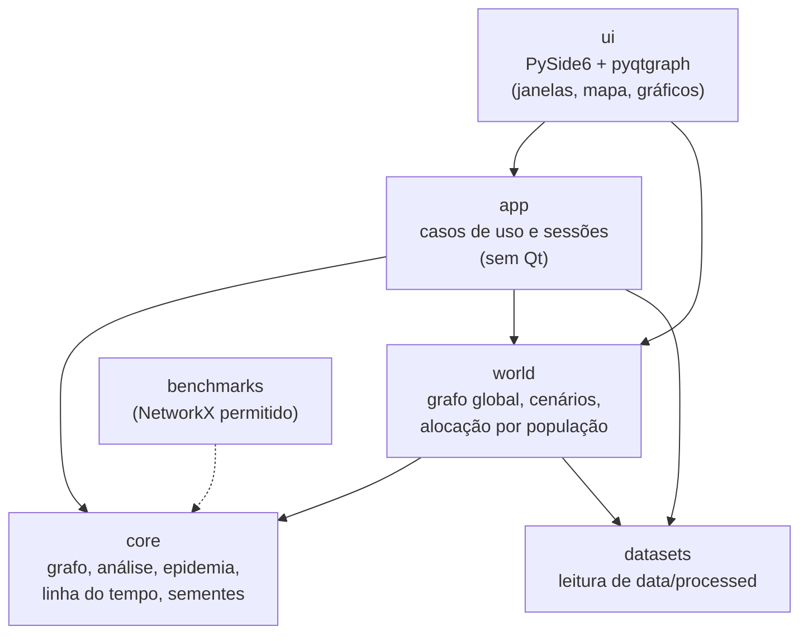

# Arquitetura e estrutura de pastas: Simulador de Epidemias em Redes

Tema 7, Teoria dos Grafos. Versão 0.5, 03/11/2026. Revisão do grupo. A v0.5 incorpora a divisão em 5 módulos e, como base, as decisões da v0.4: as decisões de 03/11/2026: universo de 229 entidades, pacote `datasets/` (em lugar de `dados/`), entrada do Natural Earth em GeoJSON, flag de vacinado na linha do tempo, regra de cor do fluxo real por intensidade, e módulos de configuração e exportação (RF07 e RF08). Itens marcados como **[pendente]** serão resolvidos durante a implementação ou dependem de terceiros.

Este documento define as camadas, as interfaces entre elas e a organização do repositório. Depende da modelagem (grafo unificado, modelo SEIRD, isolamento e vacinação automáticos, dois fluxos sobre o mesmo grafo) e usa a stack já fechada (Python 3.12, PySide6, pyqtgraph, PyInstaller, pytest). Os diagramas UML detalhados (classes, componentes, sequência e atividades) ficam a cargo de outro membro do grupo e devem seguir os nomes definidos aqui.

---

## 1. Princípios

1. **Núcleo sem interface.** As camadas de domínio (grafo, análise, epidemia, linha do tempo) não importam PySide6, pyqtgraph, pandas, NetworkX nem NumPy. Isso permite testar o núcleo com pytest sem janela e trocar a interface sem tocar nas regras.
2. **Uma única fonte de verdade para a reprodução.** A interface nunca calcula a epidemia. Ela só lê uma linha do tempo. O fluxo de simulação e o fluxo real entregam a mesma interface de leitura, e o mesmo player serve aos dois.
3. **Configuração congelada.** Os parâmetros são reunidos em um objeto imutável (`SimulationConfig`) antes do início. Depois de iniciada a simulação, nada desse objeto muda (RN01).
4. **Determinismo por subsistema.** Cada subsistema aleatório (rede, paciente zero, isolamento, vacinação, rótulos, calibração) deriva sua semente da semente global e do próprio nome, por hash estável, e usa gerador próprio (F2, RN03).
5. **Dependências em uma única direção.** Interface depende da aplicação; a aplicação depende do domínio; o domínio não depende de nada acima dele (seção 5).

---

## 2. Visão em camadas



| Camada | Responsabilidade | Pode importar | Não pode importar |
|---|---|---|---|
| `core` | Estruturas e algoritmos de grafo; modelo epidemiológico; buffer de estados; sementes | biblioteca padrão | Qt, pyqtgraph, pandas, NumPy (só nas peças do ponto 9.2, item 5), NetworkX, camadas acima |
| `world` | Construção do grafo unificado: alocação de vértices, posições, conexões geométricas, arestas por rotas, cenários | `core`, `datasets` | Qt, `app`, `ui` |
| `datasets` | Leitura dos arquivos já processados em `data/processed/` (CSV e GeoJSON) | biblioteca padrão | Qt, pandas, camadas acima |
| `app` | Casos de uso: sessão de simulação, sessão de pandemia real, controle de reprodução, métricas do painel, configuração e exportação | `core`, `world`, `datasets` | Qt, `ui` |
| `ui` | Janelas, tela inicial, painel de controles, mapa com QPainter, gráficos com pyqtgraph, thread de simulação | tudo acima, PySide6, pyqtgraph | (nenhuma restrição interna além da regra de dependência) |

A camada `ui` é a única que importa PySide6 e pyqtgraph. A camada `app` é a única que a `ui` chama para obter dados e executar ações.

---

## 3. Módulos do projeto e sua localização

Os módulos M1 a M5 do documento de apoio se mapeiam para os pacotes abaixo. A atribuição de responsáveis continua sendo decisão do grupo.

| Módulo | Pacotes | Conteúdo principal |
|---|---|---|
| M1 Núcleo do grafo | `core/graph/` | `Graph` (lista de adjacência com máscara de arestas ativas), BFS, DFS, componentes conexos, Dijkstra |
| M2 Análise de redes e benchmark | `core/analysis/`, `benchmarks/` | Grau, agrupamento, intermediação aproximada, propagação de rótulos, Tarjan (pontes e articulações); benchmark de desempenho (NetworkX só em `benchmarks/`) |
| M3 Motor de simulação | `core/epidemic/`, `core/timeline/`, `app/simulation_session.py` | Parâmetros, calibração de β, modelo SEIRD por passo, isolamento e vacinação automáticos, engine, buffer de estados |
| M4 Dados e grafo unificado | `datasets/`, `world/` | Carregamento dos processados, alocação de vértices, geometria, rede geométrica, arestas por rotas, cenários |
| M5 Interface, mapa e resultados | `ui/`, `app/playback.py`, `app/panel_metrics.py`, `app/config_io.py`, `app/export.py`, `scripts/`, `tests/` | Tela inicial, configuração, mapa, player, gráficos (`ui/charts_view.py`), métricas do painel, salvar e carregar configuração (RF07), exportação de CSV e imagem (RF08), testes, executável |

---

## 4. Interfaces entre camadas

As interfaces abaixo são o contrato que permite trabalhar em paralelo. Elas são definidas com `typing.Protocol` (ou classes simples), para que o núcleo não dependa de herança de Qt.

### 4.1 Linha do tempo: a interface que o player consome

Esta é a interface central. A simulação e o fluxo real a implementam, e a `ui` só conhece esta forma.

```python
class Timeline(Protocol):
    """Histórico de estados já disponível para reprodução."""

    num_vertices: int                 # total de vértices do grafo global
    vertex_country: Sequence[int]     # índice do país de cada vértice
    countries: Sequence[CountryInfo]  # nome, ISO3, população, geometria

    @property
    def days_available(self) -> int: ...   # dias já gravados (cresce na simulação)

    def vertex_states(self, day: int) -> bytes | None:
        """Byte por vértice no dia, com estado epidemiológico e flags (ver abaixo). None no fluxo real."""

    def country_counts(self, day: int) -> Sequence[CountryCounts]:
        """Acumulados por país no dia: casos, mortes, recuperados (ou contagens por compartimento)."""
```

**Codificação do byte de vértice.** Três bits para o estado (S = 0, E = 1, I = 2, R = 3, D = 4) e dois bits independentes para as flags:

- bit 3: **isolado** (flag de isolamento, C3 da modelagem);
- bit 4: **vacinado** (flag de vacinação, C4 da modelagem e decisão de 03/11).

Um vértice pode estar I e isolado, ou R e vacinado, ao mesmo tempo. O estado R sem a flag de vacinado é o R de origem natural, usado na comparação com dados reais (seção 7.1 da modelagem).

- **Fluxo de simulação:** `SimulationTimeline` lê de um `StateBuffer` (um `bytearray` por dia) preenchido pelo motor. `vertex_states` devolve o byte de cada vértice; `country_counts` é calculado pela agregação do buffer.
- **Fluxo real:** `RealTimeline` lê `covid19.csv`, `ebola.csv`, `h1n1.csv` e `sars.csv` já processados. `vertex_states` devolve `None`, e `country_counts` vem direto das séries.

**Regra de renderização do mapa.** O mapa tem duas camadas: uma de polígonos (um por país) e outra de vértices.

- **Polígono do país, fluxo de simulação:** pintado pelo status dominante do dia (uma cor por status: S, E, I, R, D e isolado), calculado a partir dos vértices do país.
- **Polígono do país, fluxo real (decisão de 03/11/2026):** pintado por **intensidade de casos acumulados por 100 mil habitantes**, em escala sequencial. O limiar de 10 por 100 mil (equivalente a 0,01% da população) é o início da escala. Os óbitos aparecem como indicador separado. Motivo: as séries reais trazem só acumulados, e a regra de status dominante deixaria o país sempre na cor de I quando R = 0.
- **Vértices:** aparecem apenas quando o país ocupa, na tela, uma largura em pixels igual ou superior a um limiar configurável (`limiar_vertices_px`, ajustado por teste visual no protótipo). Abaixo desse limiar, os vértices são ocultados e vale só a cor do polígono. Assim, países pequenos como Cuba, Cabo Verde ou Suíça ficam legíveis, e países grandes mostram os vértices já no zoom inicial.
- No fluxo real, os vértices não têm estado próprio: recebem a cor do polígono do país.

**Valores iniciais do limiar.** Medida: a largura, em pixels, do retângulo envolvente do país na tela (com as partes divididas no antimeridiano somadas, D15 dos dados).

| Parâmetro | Valor inicial | Justificativa |
|---|---|---|
| Limiar de entrada (mostrar vértices) | 40 px | Com 12 vértices (n_min) e marcador de 3 px, 40 px dão espaçamento médio de cerca de 10 px, suficiente para não sobrepor os marcadores. |
| Limiar de saída (ocultar vértices) | 36 px | Histerese de 4 px, para evitar piscar quando o zoom oscila em torno do limiar. |
| Diâmetro do marcador | 3 px | Legível sem cobrir o polígono. |

Referência no zoom inicial do mapa mundial, em uma janela de cerca de 1.200 px de largura (aproximadamente 3,3 px por grau de longitude): Brasil (cerca de 130 px) e Índia (cerca de 100 px) mostram vértices desde o início; Cuba (cerca de 25 px), Suíça (cerca de 15 px) e Cabo Verde (cerca de 5 px) só os mostram ao ampliar, até passarem de 40 px. Os valores são parâmetros de configuração, e devem ser conferidos no protótipo com a máquina mais fraca do grupo **[pendente: teste visual no protótipo]**.

### 4.2 Motor de simulação

```python
class EpidemicEngine:
    def __init__(self, world: World, config: SimulationConfig, seeds: SeedBook,
                 buffer: StateBuffer) -> None: ...

    def start(self, patient_zero: Sequence[int] | None) -> None: ...  # paciente zero manual ou aleatório
    def step(self) -> DayRecord: ...   # avança um dia, grava o estado no buffer, devolve o resumo do dia
    @property
    def finished(self) -> bool: ...
```

O motor não conhece Qt nem tempo de parede. Cada chamada a `step()` é um dia de simulação, e a velocidade da reprodução é tratada pela `ui`. Isso permite testar o motor em um laço simples.

### 4.3 Sessão de aplicação

```python
class SimulationSession:
    """Cenário configurado, motor e buffer. Sem Qt."""
    config: SimulationConfig      # congelado após start()
    def configure(self, config: SimulationConfig) -> None: ...
    def calibrate_beta(self) -> float: ...       # bisseção sobre simulações curtas (B2 da modelagem)
    def start(self, patient_zero: Sequence[int] | None = None) -> None: ...
    def run_day(self) -> DayRecord: ...
    def timeline(self) -> Timeline: ...          # o mesmo tipo que o fluxo real entrega
    def reset(self) -> None: ...                 # descarta o buffer e volta à configuração
```

`RealSession` tem a mesma forma de leitura (`timeline()`), sem as operações de execução. Assim a `ui` trata os dois fluxos por um único caminho de reprodução.

### 4.4 Configuração

```python
@dataclass(frozen=True)
class SimulationConfig:
    seed: int
    scenario: str                 # "global" ou "regional_ebola" (B4 da modelagem)
    contagio_r0: float            # R0 informado pelo usuário; β é calibrado a partir dele (B2)
    recuperacao_gamma: float      # ver ponto 9.2, item 9: definir se é taxa total de saída (γ)
    mortalidade: float            # fração das saídas de I que vão para D (item 5 do Bloco 2)
    incubacao_dias: float         # sigma = 1 / incubacao (H1N1 1,4 dias; SARS 4,0 dias)
    nivel_intervencao: Literal["baixo", "medio", "alto"]   # C5 da modelagem
```

Imutável por construção: qualquer alteração exige uma nova configuração e um novo início (RN01).

Salvar e carregar (RF07) usam a mesma estrutura, serializada em JSON pela biblioteca padrão (`app/config_io.py`).

### 4.5 Thread de simulação (adaptador Qt)

`SimulationThread(QThread)` fica na `ui`. Ele executa `session.run_day()` em laço, respeita pausa e parada, e emite um sinal `day_ready(int)` a cada dia gravado. A `ui` nunca lê o buffer enquanto o dia não foi anunciado pelo sinal.

---

## 5. Regras de dependência e como verificá-las

Regras (verificadas por teste automático, em `tests/architecture/test_camadas.py`, com leitura estática dos imports):

- `core` não importa `PySide6`, `pyqtgraph`, `pandas`, `networkx`, `numpy`, nem nada de `app`, `world`, `datasets` ou `ui`.
- `world` e `datasets` não importam `app` nem `ui`.
- `app` não importa `ui`, `PySide6` nem `pyqtgraph`.
- `networkx` aparece somente em `benchmarks/`.
- `numpy` não aparece em `src/` enquanto `NUMPY_LIBERADO = False` (já previsto no setup).

Essas regras complementam as regras do `ruff` (`banned-api`) já previstas no setup. O teste estático cobre o que o ruff não cobre, como a direção entre pacotes internos.

---

## 6. Fluxo de execução (visão de sequência resumida)

Simulação:

1. `ui` coleta os parâmetros na tela de configuração e cria um `SimulationConfig`.
2. `app` pede a `world` o grafo global do cenário (cache por semente e cenário, porque a construção pode levar segundos).
3. `app` cria `SimulationSession`, calibra β e a `ui` cria `SimulationThread` e o conecta a `day_ready`.
4. Após a escolha do paciente zero, a thread chama `run_day()` em laço.
5. Cada dia gravado emite o sinal; a `ui` atualiza o contador de dias disponíveis e o player pode avançar até esse dia.
6. A reprodução (play, pausa, velocidade, voltar) lê `timeline().vertex_states(day)` e não toca no motor.

Fluxo real:

1. `ui` apresenta a lista de pandemias (RF09).
2. `app` cria `RealSession` a partir de `datasets/` e de `world/` (mesmo grafo global, RF10, RF13).
3. A reprodução segue o mesmo caminho da simulação, sem a thread de execução.

---

## 7. Concorrência

- O buffer é **somente de acréscimo** (append-only): o motor grava o dia `d` e só depois anuncia `d`. A `ui` lê apenas índices já anunciados.
- Com essa disciplina não há leitura de dia parcialmente escrito. A decisão de gravar durante a execução está registrada (E2 da modelagem).
- Nenhum objeto de domínio é acessado pela `ui` durante a execução, exceto o buffer e o `SimulationConfig` congelado.
- Ao reiniciar ou trocar de cenário, a thread é interrompida (`requestInterruption` e `wait`, como na prova de conceito), o buffer é descartado e uma nova sessão é criada.

---

## 8. Estrutura de pastas do repositório

```
simulador-epidemias/
├── .github/workflows/ci.yml          # CI opcional (setup 4.4)
├── .vscode/                          # settings.json e extensions.json
├── benchmarks/                       # único lugar em que NetworkX é permitido
│   ├── README.md
│   └── bench_grafo.py
├── data/                             # preparação offline (fora do aplicativo)
│   ├── README.md                     # origem dos brutos, passo a passo, atribuições
│   ├── LICENSE-ODbL.txt              # licença do conteúdo derivado de OpenFlights (D25 dos dados)
│   ├── country_aliases.csv
│   ├── prepare_data.py
│   ├── requirements-data.txt
│   └── processed/                    # único conteúdo de dados que o app lê (versionado)
├── docs/
│   ├── arquitetura.md                # este documento
│   ├── modelagem_simulador_epidemias.md
│   ├── dados_datasets_e_preparacao.md
│   ├── setup_ambiente.md
│   ├── diagramas/                    # UML em Mermaid ou PlantUML (outro membro)
│   └── relatorio/                    # fontes .tex que vão no .zip
├── scripts/
│   └── build_exe.ps1
├── src/epidemia/
│   ├── __init__.py
│   ├── main.py                       # ponto de entrada: monta a aplicação e a janela
│   ├── config.py                     # caminhos de data/processed, constantes globais
│   ├── core/                         # domínio puro, sem Qt
│   │   ├── __init__.py
│   │   ├── errors.py                 # exceções próprias (RNF08)
│   │   ├── seeds.py                  # derivação de sementes por subsistema (hashlib)
│   │   ├── graph/
│   │   │   ├── __init__.py
│   │   │   ├── graph.py              # Graph: lista de adjacência e máscara de arestas
│   │   │   ├── traversal.py          # BFS, DFS, componentes conexos
│   │   │   └── shortest_path.py      # Dijkstra
│   │   ├── analysis/
│   │   │   ├── __init__.py
│   │   │   ├── metrics.py            # grau, agrupamento (local e global), intermediação aproximada
│   │   │   ├── communities.py        # propagação de rótulos
│   │   │   └── bridges.py            # Tarjan: pontes e articulações
│   │   ├── epidemic/
│   │   │   ├── __init__.py
│   │   │   ├── parameters.py         # SimulationConfig e tabela de níveis (C5)
│   │   │   ├── calibration.py        # calibração de β por bisseção (B2)
│   │   │   ├── model.py              # transições SEIRD por passo (1 - exp)
│   │   │   ├── interventions.py      # isolamento e vacinação automáticos
│   │   │   └── engine.py             # EpidemicEngine
│   │   └── timeline/
│   │       ├── __init__.py
│   │       ├── buffer.py             # StateBuffer: um bytearray por dia, com flags (isolado e vacinado)
│   │       └── protocol.py           # Timeline (interface de leitura)
│   ├── world/                        # grafo global e cenários
│   │   ├── __init__.py
│   │   ├── world.py                  # World: grafo, países, vertex_country, posições
│   │   ├── allocation.py             # alocação de vértices por população (iterativa)
│   │   ├── geometry.py               # ponto-em-polígono, centroide, sorteio de posições
│   │   ├── spatial_grid.py           # grade espacial para conexões geométricas
│   │   ├── builder.py                # conexões internas e arestas por rotas (D18)
│   │   └── scenarios.py              # cenário global e cenário regional (Ebola)
│   ├── datasets/                     # leitura de data/processed (stdlib: csv, json)
│   │   ├── __init__.py
│   │   ├── loaders.py                # countries.csv, edges.csv, countries.geojson
│   │   └── series.py                 # covid19, ebola, h1n1, sars
│   ├── app/                          # casos de uso, sem Qt
│   │   ├── __init__.py
│   │   ├── simulation_session.py
│   │   ├── real_session.py
│   │   ├── playback.py               # estado da reprodução: dia atual, velocidade, pausa
│   │   ├── panel_metrics.py          # pico, duração, mortes, R0 efetivo (SEIR), percentual
│   │   ├── config_io.py              # salvar e carregar configuração em JSON (RF07)
│   │   └── export.py                 # exportação de CSV a partir da linha do tempo (RF08)
│   └── ui/                           # PySide6 e pyqtgraph
│       ├── __init__.py
│       ├── main_window.py
│       ├── start_screen.py           # escolha entre os dois fluxos (RF25)
│       ├── config_panel.py           # campos e sliders dos parâmetros (RF23)
│       ├── map_view.py               # mapa com QPainter em lote (RF22, RF26)
│       ├── charts_view.py            # curvas S, E, I, R, D com pyqtgraph (RF24); exportação de imagem (RF08)
│       ├── player_bar.py             # play, pausa, velocidade, linha do tempo
│       ├── simulation_thread.py      # QThread que executa a sessão (RNF03)
│       └── styles.py                 # cores dos estados, escala do fluxo real e tema claro/escuro
├── tests/
│   ├── conftest.py
│   ├── architecture/
│   │   └── test_camadas.py           # regras de dependência (seção 5)
│   ├── core/                         # grafo, análise, epidemia, buffer, sementes
│   ├── world/                        # alocação, geometria, builder, cenários
│   ├── datasets/                     # esquemas de data/processed (seção 7.6 dos dados)
│   └── app/                          # sessões, reprodução, configuração e exportação
├── .gitattributes
├── .gitignore
├── pyproject.toml
├── README.md
├── requirements.txt                  # PySide6, pyqtgraph
└── requirements-dev.txt              # + pytest, ruff, pyinstaller, networkx
```

Observações sobre a estrutura:

- O pacote de dados se chama `datasets/` (decisão C2, 03/11/2026), para não confundir com a pasta `data/` da raiz, que é de preparação offline. Os nomes de código ficam em inglês, e a documentação em português.
- `core/` não tem nenhum arquivo que importe bibliotecas de terceiros. Essa é a garantia de que o núcleo continua "próprio", como exige o enunciado.
- Os testes espelham os pacotes, o que facilita localizar o teste de cada módulo e atribuir responsáveis.
- `main.py` continua sendo o ponto de entrada (`python -m epidemia.main`), como já previsto no setup e no `build_exe.ps1`.

---

## 9. Decisões desta versão e pontos para discussão

### 9.1 Decisões (a confirmar)

| # | Decisão | Motivo |
|---|---|---|
| A1 | Quatro camadas (`core`, `world`/`datasets`, `app`, `ui`) com dependência em uma direção | Permite testar o domínio sem janela e dividir o trabalho entre membros |
| A2 | `Timeline` como interface única de reprodução para os dois fluxos | Um só player (decisão de 2.3 do documento de apoio) |
| A3 | `SimulationConfig` imutável | Garante RN01 por construção, não por disciplina |
| A4 | Sementes derivadas por `hashlib`, nunca por `hash()` | `hash()` do Python varia entre execuções; `hashlib` garante RN03 |
| A5 | Buffer somente de acréscimo, anunciado por sinal | Leitura segura entre thread e interface sem travas complexas |
| A6 | Regras de dependência verificadas por teste automático | Evita que a interface vaze para o domínio ao longo do desenvolvimento |
| A7 | Pacote `datasets/` lê só `data/processed/` com `csv` e `json` da biblioteca padrão | pandas fica fora do aplicativo (setup, D5 a D7 dos dados) |
| A8 | `benchmarks/` fora de `src/` | NetworkX só no benchmark (regra do enunciado) |
| A9 | Pacote de dados renomeado para `datasets/`; nomes de código em inglês (C2) | Evita confusão com `data/`; convenção decidida em 03/11 |
| A10 | Flags de isolado e vacinado no byte de cada vértice (bits 3 e 4) | Permite comparar R sem vacinados com os dados reais (C3, C4 e item 3 do Bloco 2) |
| A11 | Entrada do Natural Earth em GeoJSON, lida pela biblioteca padrão | Elimina `pyshp` do fluxo de dados e mantém o aplicativo sem dependências de geometria |
| A12 | Regra de cor do fluxo real por intensidade de casos por 100 mil habitantes | Evita que o país fique sempre na cor de I quando R = 0 (item 4 do Bloco 2) |
| A13 | Módulos `app/config_io.py` (RF07) e `app/export.py` (RF08), com a imagem em `ui/charts_view.py` | Dá lugar aos requisitos que a v0.3 não cobria (B9) |
| A14 | Cálculo de β por bisseção antes do início, em `core/epidemic/calibration.py` | Torna o R0 informado pelo usuário efetivo no grafo gerado (B2) |

### 9.2 Pontos para discutir

1. **Gravação do histórico (E2).** Decidido: gravar durante a execução, com reprodução começando assim que o primeiro dia for anunciado.

2. **Cor dos países e exibição dos vértices (seção 4.1).** Decidido: no fluxo de simulação, status dominante; no fluxo real, intensidade por casos por 100 mil habitantes (A12). Os limiares de 40 px e 36 px são iniciais, a validar no protótipo.

3. **Cache do grafo global.** A construção (alocação, conexões geométricas, arestas por rotas) pode demorar. Proposta: montar uma vez por (semente, cenário) e reutilizar nos reinícios. Precisa de medição na máquina mais fraca (benchmark do setup, passo 13).

4. **Geometria no aplicativo (pendência do setup).** O sorteio de posições e o ponto-em-polígono usam só a biblioteca padrão, em `world/geometry.py`. Decidido: manter assim, sem `shapely` no aplicativo.

5. **Efeito da liberação de NumPy.** Proposta: não expor NumPy fora de `core/timeline/buffer.py` e `core/epidemic/engine.py`. Assim, a troca fica confinada a essas duas peças e aos testes. **Liberado pelo professor (03/11/2026); a proposta de confinamento é mantida.**

6. **Universo de entidades.** Resolvido: 229 entidades (dados v0.7, modelagem). O `world/` lê o número de `countries.csv`, então o código não depende do valor.

7. **Nomes de código em inglês e documentação em português (C2).** Decidido em 03/11/2026. Os nomes da estrutura acima já seguem essa convenção.

8. **Tratamento de erros (RNF08).** Proposta: exceções próprias em `core/errors.py` (ex.: `ParametroForaDaFaixa`, `DatasetInvalido`), capturadas pela `ui` e exibidas em caixa de diálogo.

9. **Parâmetros da configuração (γ).** [discutir] O modelo define γ como taxa total de saída de I, dividida entre D e R pela mortalidade (modelagem 4.2). A `SimulationConfig` atual traz `recuperacao_gamma` e `mortalidade`. O grupo precisa decidir se o usuário informa γ diretamente (e a mortalidade divide a saída) ou a taxa de recuperação (e γ é calculado). Isso afeta o campo de RF01.

---

## 10. Pendências desta etapa

- **[pendente]** Conferir os valores iniciais do limiar (40 px de entrada, 36 px de saída) no protótipo, na máquina mais fraca do grupo.
- **[pendente]** Conferir o `countries.geojson` gerado pelo script de dados contra o formato usado por `datasets/` (D20 dos dados). O arquivo bruto do Natural Earth já foi recebido e será convertido para GeoJSON antes da execução do script.
- **Resolvido (03/11/2026):** o professor liberou NumPy no núcleo (ponto 9.2, item 5) e uso de shapely no script de dados.
- **[pendente]** Decisão sobre o campo de γ na configuração (ponto 9.2, item 9).
- **[pendente]** Divisão de tarefas entre os integrantes, definida pelo grupo, fora dos documentos.
- **[pendente]** Diagramas UML (outro membro), com os nomes desta versão.
- Depois de validado: criar o esqueleto de pastas e os `__init__.py` no repositório, e substituir a prova de conceito de `main.py` pelo esqueleto da arquitetura, mantendo a verificação de FPS do setup.

---

## 11. Histórico de alterações

| Versão | Data | Mudanças |
|---|---|---|
| 0.1 | 17/10/2026 | Primeira versão: camadas, interfaces e estrutura de pastas. |
| 0.2 | 31/10/2026 | Regra de renderização do mapa; respostas às pendências de implementação. |
| 0.3 | 03/11/2026 | Valores iniciais do limiar de vértices (40 px e 36 px); decisões 9.1 e 9.2. |
| 0.5 | 03/11/2026 | Divisão em 5 módulos (seção 3): M6 incorporado ao M5; `benchmarks/` atribuído ao M2; `app/panel_metrics.py`, `app/config_io.py`, `app/export.py` e `ui/charts_view.py` passam ao M5. Referências a M6 removidas. |
| 0.4 | 03/11/2026 | Pacote `dados/` renomeado para `datasets/` (C2); flags de isolado e vacinado no byte de vértice (4.1, A10); entrada do Natural Earth em GeoJSON (A11); cor do fluxo real por intensidade (4.1, A12); módulos de RF07 e RF08 (3, 8, A13); calibração de β (4.3, 8, A14); pontos de discussão atualizados, com decisões de gravação (E2), universo de 229 entidades e nomes em inglês (C2); novo ponto sobre o campo de γ na configuração (9.2, item 9). |
