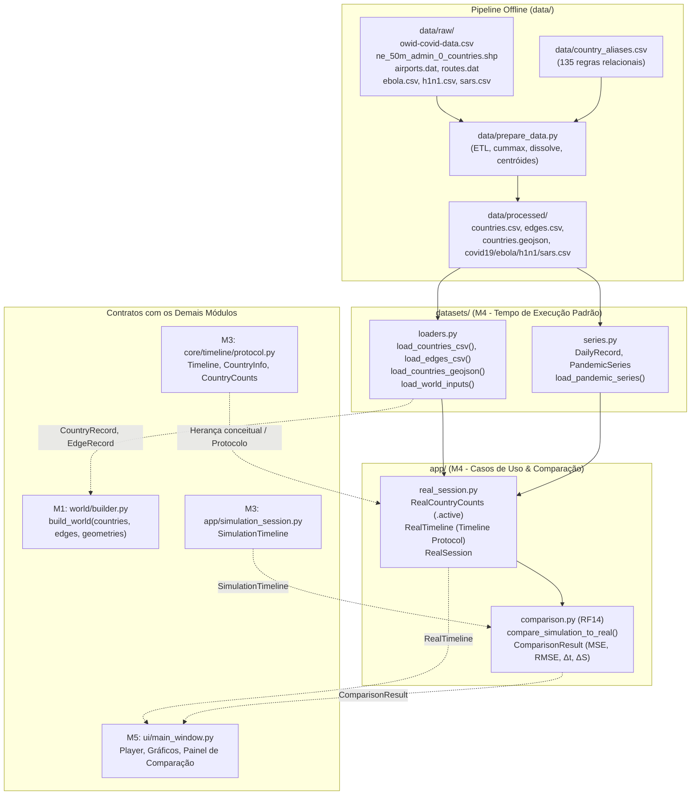

# Guia de Estudo e Plano de Implementação — Módulo 4 (Dados e Comparação com a Realidade)

Este documento é o seu **manual completo de engenharia de dados, normalização geográfica, modelagem epidemiológica comparativa e interoperabilidade arquitetural** para o **Módulo 4 (Responsável D)** do Simulador de Epidemias em Redes. Ele consolida todas as decisões dos documentos [arquitetura_simulador_epidemias.md](file:///d:/Henrique%20Faculdade/Graph-Epidemic-Simulator/docs/planning-dev-docs/LLMFiles/arquitetura_simulador_epidemias.md) (v0.6), [dados_datasets_e_preparacao.md](file:///d:/Henrique%20Faculdade/Graph-Epidemic-Simulator/docs/planning-dev-docs/LLMFiles/dados_datasets_e_preparacao.md), [modelagem_simulador_epidemias.md](file:///d:/Henrique%20Faculdade/Graph-Epidemic-Simulator/docs/planning-dev-docs/LLMFiles/modelagem_simulador_epidemias.md), [responsabilidades_modulos.md](file:///d:/Henrique%20Faculdade/Graph-Epidemic-Simulator/docs/planning-dev-docs/LLMFiles/responsabilidades_modulos.md) e [documento_apoio_simulador_epidemias.md](file:///d:/Henrique%20Faculdade/Graph-Epidemic-Simulator/docs/planning-dev-docs/LLMFiles/documento_apoio_simulador_epidemias.md), além de mapear as interfaces reais integradas com os módulos **M1**, **M2**, **M3** e **M5**.

---

## 1. Visão Geral do seu Escopo (O que é o Módulo 4?)

Ao cruzar o documento de **Responsabilidades por Módulo** com o de **Arquitetura (v0.6)**, o papel do **Responsável D (M4)** abrange cinco frentes complementares:

1. **Bloco 1 — Pipeline Offline de Engenharia de Dados (`data/` e `data/prepare_data.py`)**:
   - Criação da tabela relacional de 135 regras de normalização e aliases (`data/country_aliases.csv`).
   - Construção do script autônomo de ETL (`data/prepare_data.py`) que processa as quatro fontes primárias brutas offline (Our World in Data, Natural Earth 50m, OpenFlights e séries temporais da OMS/JHU/Kaggle).
   - Fechamento estrito do universo de simulação em **229 entidades soberanas** (Decisões D8, D9, D19, D24), agregação dos 8 territórios sem geometria própria, interpolação contínua e garantia monótona $\text{cummax}(t)$ antes da soma no país soberano (Decisão D21).
   - Tratamento poligonal e cálculo de centróides imunes à distorção do antimeridiano ($\pm 180^\circ$, Decisões D15, D20).
   - Filtragem da malha aérea internacional: descarte de voos *codeshare* (`=Y`), conversão de rotas território-metrópole em domésticas e agregação não direcionada $A < B$ (Decisões D13, D14, D16).
2. **Bloco 2 — Camada de Leitura em Tempo de Execução (`src/epidemia/datasets/`)**:
   - Implementação de carregadores estáticos (`loaders.py`) para `countries.csv`, `edges.csv` e `countries.geojson`, fornecendo interoperabilidade direta via *duck typing* (`load_world_inputs()`) com o construtor do grafo global unificado (`world.builder.build_world` do M1), sem violar o isolamento de camadas.
   - Implementação da estrutura em memória de séries temporais de pandemias históricas (`series.py`), suportando acesso por hash em tempo constante $O(1)$ por país e por dia para COVID-19, Ebola, H1N1 e SARS (RF09, RF11).
3. **Bloco 3 — Linha do Tempo do Fluxo Real (`src/epidemia/app/real_session.py`)**:
   - Cumprimento rigoroso do contrato polimórfico `@runtime_checkable class Timeline(Protocol)` definido pelo M3 (`RealTimeline`), permitindo que a interface gráfica e o player (M5) reproduzam tanto simulações estocásticas quanto pandemias históricas com o mesmo caminho de código (RF11, RF12, Decisão A2).
   - Fornecimento da estrutura `RealCountryCounts` com cálculo transparente da propriedade `.active` para alimentação dos painéis e gráficos analíticos de M5 (`app/panel_metrics.py`).
   - Implementação do Dia 0 no fluxo real proporcional à população real correspondente a $M=1$ vértice no modelo (Decisão A18).
4. **Bloco 4 — Confrontação Quantitativa e Métricas Científicas (`src/epidemia/app/comparison.py`)**:
   - Implementação das métricas quantitativas do requisito **RF14**: alinhamento temporal pelo Dia 0, normalização por frações populacionais $y(k) = C(k) / N$, cálculo de MSE, RMSE, erro de dia de pico ($\Delta t_{\text{pico}}$), erro de magnitude de pico ($\Delta \text{PeakMag}$) e discrepância de tamanho epidêmico final ($\Delta S_\infty$).
   - Estruturação do resultado imutável `ComparisonResult`, provendo sumários executivos formatados para a interface e relatórios detalhados para auditoria acadêmica.
5. **Bloco 5 — Governança de Licenças, Testes e Documentação Acadêmica**:
   - Documentação de proveniência, direitos autorais e licença de banco de dados aberto **ODbL 1.0** para os dados derivados em `data/README.md` (Decisão D25, RNF09).
   - Suíte de 21 testes unitários automatizados cobrindo casos limites, CSVs malformados, GeoJSON heterogêneo, integridade do protocolo `Timeline` e cálculo manual de métricas estatísticas.

> [!IMPORTANT]
> **Regras de Ouro das Camadas (`tests/architecture/test_camadas.py` e Arquitetura Seção 5):**
> 1. Nenhum arquivo em `src/epidemia/datasets/` pode importar `PySide6`, `pyqtgraph`, `pandas`, `networkx`, `shapely`, `core`, `world`, `app` ou `ui`. Todo o pacote opera **exclusivamente com a biblioteca padrão do Python** (`csv`, `json`, `dataclasses`, `pathlib`).
> 2. Nenhum arquivo em `src/epidemia/app/` pode importar `ui`, `PySide6`, `pyqtgraph`, `pandas`, `networkx` ou `shapely`.
> 3. **Confinamento de Dependências Pesadas:** O script `data/prepare_data.py` roda como ferramenta CLI offline de preparação. Apenas ele utiliza `pandas` e `shapely`. O aplicativo em tempo de execução lê unicamente arquivos prontos de `data/processed/` (RNF10).
> 4. **Estilo e Formatação:** Limite estrito de `100` caracteres por linha, Python 3.12 (`from __future__ import annotations`), identificadores em inglês e documentação em português.

---

## 2. Mapa de Dependências e Contratos no Repositório

### 2.1. Assinaturas Exatas Consumidas de M1, M2 e M3

1. **De `src/epidemia/core/timeline/protocol.py` (M3):**
   - Protocolo `@runtime_checkable class Timeline(Protocol)`:
     - `days_available: int`
     - `countries: Sequence[CountryInfo]`
     - `vertex_country: Sequence[int]`
     - `vertex_states(day: int) -> bytes | None`
     - `country_counts(day: int) -> Sequence[CountryCounts]`
   - Dataclass `CountryInfo`: `iso3: str`, `name: str`, `population: int`, `geometry: Any = None`.
   - Dataclass `CountryCounts`: `iso3: str`, `susceptible: int`, `exposed: int`, `infected: int`, `recovered_natural: int`, `recovered_vaccinated: int`, `deceased: int`, `isolated: int`, com propriedades `cumulative_cases`, `total_recovered`, `deaths`, `total_vertices`, `dominant_state`.
2. **De `src/epidemia/core/timeline/buffer.py` (M3):**
   - Constante `DEFAULT_DAY_ZERO_VERTEX_THRESHOLD: int = 1`.
   - Método `country_day_zero(country, threshold_m)` em `SimulationTimeline`.
3. **De `src/epidemia/world/world.py` (M1):**
   - Objeto `World`: consumido opcionalmente por `RealTimeline.from_world(world, series)` para unificar os metadados de países e centróides.

### 2.2. Assinaturas Exatas Entregues por M4 para M1, M3 e M5

1. **Para `src/epidemia/world/builder.py` (M1):**
   - `load_world_inputs(processed_dir)`: devolve tupla `(list[CountryRecord], list[EdgeRecord], dict[str, dict])`, onde:
     - `CountryRecord` possui `.iso3`, `.name`, `.population`, `.geometry`, `.continent`;
     - `EdgeRecord` possui `.iso3_a`, `.iso3_b`, `.routes`.
   - Permite que o M1 execute `build_world()` diretamente sem conhecer o formato de serialização dos arquivos em disco.
2. **Para `src/epidemia/ui/main_window.py` (M5):**
   - `RealSession(processed_dir)`: fachada para alternar entre as 4 pandemias (`switch_pandemic("covid19" | "ebola" | "h1n1" | "sars")`), inspecionar metadados (`current_pandemic_info`) e obter a linha do tempo (`timeline() -> RealTimeline`).
   - `compare_simulation_to_real(sim_timeline, real_timeline, country_iso3=None)`: retorna `ComparisonResult` com métodos `formatted_summary()` e `detailed_report()`.

---

## 3. Estudo Aprofundado por Arquivo e Decisões de Projeto

Abaixo apresentamos o detalhamento técnico e a fundamentação matemática de cada componente desenvolvido.

---

### Passo 1 — Carregadores Estáticos e Entidades de Dados (`src/epidemia/datasets/loaders.py`)

* **Por que existe:** Atende a `RF10`, `RF13`, `RNF10` e às Decisões D13, D14, D16 e D20. Carrega os arquivos essenciais de `data/processed/` sem dependências externas.
* **Fundamentação Técnica:**
  - `CountryRecord`: Dataclass imutável (`frozen=True`, `slots=True`) com tipagem estrita para validação demográfica e espacial. Garante que populações sejam inteiros não-negativos e coordenadas geográficas pertençam a $[-90, +90]$ e $[-180, +180]$.
  - `EdgeRecord`: Modela arestas de transporte internacional com ordem canônica lexicográfica ($A < B$), impedindo grafos direcionados espúrios ou auto-laços ($A == B$).
  - `load_countries_geojson()`: Parser tolerante a variações do Natural Earth, priorizando a propriedade `ISO_A3_EH` e utilizando `ADM0_A3` como alternativa segura (Decisão D20).
  - `load_world_inputs()`: Fábrica adaptadora que consolida a malha completa para o construtor do mundo (`world.builder.build_world`), respeitando a fronteira arquitetural entre M4 e M1.

---

### Passo 2 — Séries Temporais de Pandemias Históricas (`src/epidemia/datasets/series.py`)

* **Por que existe:** Atende a `RF09`, `RF11` e às Decisões D10, D11, D12, D21, D22 e D23. Fornece acesso estruturado e ultra-rápido aos dados epidemiológicos históricos.
* **Fundamentação Técnica:**
  - `DailyRecord`: Registro tabular compacto (`iso3`, `date`, `day_index`, `cases`, `deaths`, `recovered`).
  - `PandemicSeries`: Container em memória com indexação em tempo constante:
    - `_by_country_and_day: dict[tuple[str, int], DailyRecord]`: permite consultas em $O(1)$ durante a animação do player.
    - `_by_country: dict[str, list[DailyRecord]]`: possibilita extração de trajetórias completas em $O(1)$ para geração de gráficos.
    - `_unique_dates`: lista cronológica estrita que converte datas civis ISO-8601 (`YYYY-MM-DD`) em índices inteiros $[0, T-1]$.
    - `daily_totals(day) -> tuple[int, int, int]`: calcula o total acumulado global em $O(M)$ com cache automático.
  - Tratamento diferenciado de recuperados: apenas a série do SARS possui registros clínicos de recuperação; nas demais pandemias, o campo é normalizado para `0` ou omitido sem quebrar a integridade do modelo.

---

### Passo 3 — Linha do Tempo Real e Protocolo Unificado (`src/epidemia/app/real_session.py`)

* **Por que existe:** Atende a `RF11`, `RF12`, `RN01` e às Decisões A2, A10, A12 e A18. Permite que a mesma infraestrutura de interface gráfica manipule simulações estocásticas e dados reais.
* **Fundamentação Técnica:**
  - **Herança de Protocolo:** `RealTimeline` cumpre `@runtime_checkable class Timeline(Protocol)`:
    - `days_available`: retorna o horizonte temporal da pandemia selecionada.
    - `vertex_states(day)`: retorna sempre `None` (Decisão A12: dados reais não possuem micro-estados estocásticos individuais por indivíduo na malha do grafo; a interface pinta os polígonos dos países com base nas taxas de prevalência).
    - `country_counts(day)`: sintetiza objetos `RealCountryCounts` com contagens reais de casos, óbitos e ativos, mantidos em cache indexado por dia.
  - **Propriedade `.active` em `RealCountryCounts`:**
    $$I_{\text{ativo}} = \max\left(0, \text{casos} - (\text{óbitos} + \text{recuperados})\right)$$
    Essencial para alimentar os painéis analíticos de M5 (`app/panel_metrics.py`), garantindo que o número de casos ativos seja exibido sem exceções de atributo.
  - **Cálculo de Dia 0 por País (`country_day_zero`):**
    No modelo SEIRD simulado, o Dia 0 ocorre quando $M=1$ vértice é infectado no país. No fluxo real, a escala demográfica é proporcional:
    $$\text{Threshold Real} = \max\left(1, \left\lfloor \frac{\text{População Real}}{N_{\text{país, sim}}} \right\rfloor\right)$$
    Isso assegura alinhamento físico correto entre curvas sintéticas e históricas.
  - **Fachada `RealSession`:** Abstração de alto nível que provê listagem de pandemias disponíveis, metadados históricos (agente etiológico, período, países afetados) e alternância limpa sem efeitos colaterais.

---

### Passo 4 — Comparação Quantitativa com a Realidade (`src/epidemia/app/comparison.py`)

* **Por que existe:** Atende integralmente ao requisito **RF14** e às Decisões A18 e 7.1 da Modelagem. Realiza a avaliação formal entre a hipótese simulada e os dados empíricos observados.
* **Fundamentação Matemática:**
  1. **Alinhamento Temporal pelo Dia 0:**
     Calcula $t_0^{\text{sim}}$ e $t_0^{\text{real}}$ a partir do limiar demográfico de primeiro contágio ($M=1$). O horizonte de avaliação é a intersecção útil:
     $$T_{\text{comum}} = \min(T_{\text{sim}} - t_0^{\text{sim}}, T_{\text{real}} - t_0^{\text{real}})$$
  2. **Normalização por Proporção Populacional:**
     Como o grafo simulado possui tamanho $N \le 8.000$ e a população real é da ordem de bilhões, a confrontação bruta é inviável. As curvas são convertidas para frações populacionais adimensionais:
     $$y_{\text{sim}}(k) = \frac{C_{\text{sim}}(t_0^{\text{sim}} + k)}{N_{\text{sim}}}, \quad y_{\text{real}}(k) = \frac{C_{\text{real}}(t_0^{\text{real}} + k)}{\text{População Real}}$$
     onde $C_{\text{sim}} = I + R_{\text{natural}} + D$ (excluindo os expostos $E$, que não são detectados clinicamente, e vacinados $R_{\text{vacinado}}$).
  3. **Métricas de Erro Quadrático (MSE e RMSE):**
     $$\text{MSE} = \frac{1}{T_{\text{comum}}} \sum_{k=0}^{T_{\text{comum}}-1} \left( y_{\text{sim}}(k) - y_{\text{real}}(k) \right)^2, \quad \text{RMSE} = \sqrt{\text{MSE}}$$
  4. **Erro de Tempo de Pico ($\Delta t_{\text{pico}}$):**
     $$\Delta t_{\text{pico}} = k_{\text{pico, sim}} - k_{\text{pico, real}}$$
     onde $k_{\text{pico}}$ é o dia de máxima incidência de novos casos diários ($\operatorname{argmax}_k [C(k) - C(k-1)]$).
  5. **Erro de Magnitude de Pico ($\Delta \text{PeakMag}$):**
     $$\Delta \text{PeakMag} = \max_k \Delta y_{\text{sim}}(k) - \max_k \Delta y_{\text{real}}(k)$$
  6. **Discrepância de Tamanho Final ($\Delta S_\infty$):**
     $$\Delta S_\infty = y_{\text{sim}}(T_{\text{comum}}-1) - y_{\text{real}}(T_{\text{comum}}-1)$$
  - **`ComparisonResult`:** Estrutura imutável que agrega todos os parâmetros e fornece relatórios pré-formatados em texto puro e Markdown para exibição em widgets da interface gráfica.

---

### Passo 5 — Pipeline Offline de Engenharia de Dados (`data/`)

* **Por que existe:** Atende a `RF10`, `RF13`, `RNF09`, `RNF10` e a todas as Decisões D8 a D25. Garante a integridade relacional, espacial e epidemiológica das fontes antes da distribuição do projeto.
* **Fundamentação Técnica e Regras Específicas:**
  - **`data/country_aliases.csv` (135 regras relacionais):**
    - Mapeia 135 entidades divergentes entre OWID, Natural Earth e OpenFlights.
    - Exclusão formal de navios (*Diamond Princess*, *MS Zaandam*) e dependências inabitadas (Decisão D8).
    - Agregação compulsória dos 8 territórios sem geometria própria ao país soberano (Decisão D9): Gibraltar $\to$ GBR; Bonaire/Saba/Eustatius $\to$ NLD; Tokelau $\to$ NZL; Guadalupe, Guiana Francesa, Martinica, Mayotte e Reunião $\to$ FRA.
    - Normalização de Kosovo (`OWID_KOS` $\to$ `KOS`, Decisão D19) e fusão demográfica do Norte do Chipre ao Chipre (`OWID_CYN` $\to$ `CYP`, Decisão D24).
  - **`data/prepare_data.py` (Script de ETL com CLI):**
    - Executável autônomo via linha de comando (`python data/prepare_data.py --raw data/raw --out data/processed`).
    - Resolve o cálculo de centróides sobre o antimeridiano ($\pm 180^\circ$) para Rússia, Estados Unidos, Fiji, Kiribati e Nova Zelândia (Decisão D15).
    - Consolida malha aérea internacional agregando pares não direcionados $A < B$, eliminando arestas de voos compartilhados (*codeshare*) e descartando conexões com territórios agregados (Decisões D13, D14).
    - Garante que a interpolação temporal de datas faltantes e o operador monótono $\text{cummax}(t)$ sejam aplicados **antes** de somar os números epidemiológicos de territórios agregados à metrópole (Decisão D21).
    - Trata discrepâncias documentadas da literatura: na Libéria durante o Ebola, descarta a série redundante *Liberia 2* (Decisão D22); na China durante o SARS, corrige a queda anômala de 12/04/2003 mantendo o valor acumulado de 1.309 casos (Decisão D23).
  - **`data/README.md`:**
    - Documenta detalhadamente as fontes primárias, licenças de origem e a licença dos dados derivados sob os termos da **Open Database License (ODbL 1.0)**, conforme a Decisão D25.

---

## 4. Complexidade Assintótica (Tabela para o Artigo SBC)

A tabela abaixo sumariza a eficiência computacional de todos os algoritmos implementados no Módulo 4:

| Componente / Algoritmo | Arquivo | Complexidade de Tempo | Complexidade de Espaço | Justificativa Técnica |
|---|---|---|---|---|
| **Pipeline ETL (`prepare_data.py`)** | `data/prepare_data.py` | $O(N \log N)$ | $O(N)$ | Leitura das tabelas, ordenação temporal e junção espacial poligonal (*offline*). |
| **Leitura de Países (`load_countries_csv`)** | `datasets/loaders.py` | $O(M)$ | $O(M)$ | Varredura linear do arquivo CSV para as $M = 229$ entidades soberanas. |
| **Leitura de Arestas (`load_edges_csv`)** | `datasets/loaders.py` | $O(E_{\text{aéreo}})$ | $O(E_{\text{aéreo}})$ | Leitura linear de $\approx 2.200$ conexões aéreas internacionais consolidadas. |
| **Leitura de Polígonos (`load_countries_geojson`)** | `datasets/loaders.py` | $O(M \cdot K_{\text{coords}})$ | $O(M \cdot K_{\text{coords}})$ | Parsing JSON das feições geométricas e indexação por código ISO3. |
| **Leitura de Séries (`load_pandemic_series`)** | `datasets/series.py` | $O(T \cdot M)$ | $O(T \cdot M)$ | Indexação direta por hash `(iso3, day)` para busca temporal imediata em $O(1)$. |
| **Acesso a Registro Diário (`get_record`)** | `datasets/series.py` | $O(1)$ | $O(1)$ | Busca por chave de hash tupla `(iso3, dia)` em dicionário nativo. |
| **Passo do Player Real (`country_counts`)** | `app/real_session.py` | $O(M)$ (1ª vez) / $O(1)$ (cache) | $O(M)$ por dia | Instanciação das $M=229$ estruturas `RealCountryCounts` com memoização por dia. |
| **Cálculo de Dia 0 (`country_day_zero`)** | `app/real_session.py` | $O(T)$ | $O(1)$ | Busca linear ao longo dos $T$ dias cronológicos até atingir o limiar de casos. |
| **Comparação Quantitativa (`compare_simulation_to_real`)** | `app/comparison.py` | $O(T_{\text{comum}})$ | $O(T_{\text{comum}})$ | Varredura linear única sobre as trajetórias alinhadas ($T_{\text{comum}} \le 1.100$ dias). |

---

## 5. Limitações Estruturais e Metodológicas (Para o Artigo SBC)

Como parte dos requisitos acadêmicos, as seguintes limitações metodológicas devem ser destacadas:

1. **Malha Aérea Estática de 2014:**
   Os dados do OpenFlights refletem a topologia de voos globais de junho de 2014. Embora forneçam uma representação realista da conectividade aérea planetária, essa malha estática foi aplicada uniformemente a surtos anteriores (SARS 2003, H1N1 2009) e posteriores (COVID-19 2020), não capturando variações dinâmicas de fechamento de fronteiras ou crescimento de rotas.
2. **Denominador Populacional Fixo (Censo 2022):**
   As populações nacionais extraídas do Our World in Data são fixas (ano-base 2022). Em comparações históricas de surtos ocorridos há duas décadas (como o SARS de 2003), a fração populacional utiliza a população contemporânea como denominador, introduzindo uma pequena distorção percentual.
3. **Países sem Conexão Aérea Internacional Direta:**
   Microestados e territórios soberanos sem aeroportos internacionais comerciais registrados no OpenFlights (ex.: Andorra, Vaticano, San Marino, Mônaco, Liechtenstein) permanecem desconectados na malha aérea (Decisão D16). No modelo, essas entidades não propagam nem recebem infecções por vias aéreas, a menos que compartilhem fronteira terrestre em cenários locais.
4. **Ausência de Dados Históricos de Recuperados:**
   Nas séries de COVID-19, Ebola e H1N1, as agências internacionais e os repositórios públicos não mantiveram séries consistentes de casos recuperados ativos ao longo de todo o surto. Dessa forma, a validação desses surtos foca na curva de casos acumulados ($C(t)$) e óbitos ($D(t)$), enquanto a comparação com recuperados é viável exclusivamente para o SARS.
5. **Subnotificação Inerente aos Dados Empíricos:**
   Os registros das quatro pandemias representam casos confirmados laboratorialmente pelos sistemas públicos de saúde de cada país, sofrendo impactos de capacidade de testagem e atrasos de notificação, enquanto a simulação em grafos computa o estado biológico real dos nós suscetíveis e expostos.

---

## 6. Roteiro dos 5 Commits Realizados

Para manter histórico de desenvolvimento limpo e modular, a implementação de M4 foi rigorosamente particionada em **5 commits individuais**:

| Commit | Mensagem Exata do Commit | Arquivos Incluídos | Testes e Validações |
|---|---|---|---|
| **Parte 1** | `feat(datasets): implement CSV and GeoJSON loaders for world network (M4 - Part 1/5)` | `src/epidemia/datasets/loaders.py` `src/epidemia/datasets/__init__.py` `tests/datasets/test_loaders.py` | 8 testes unitários: carregamento correto, colunas ausentes, auto-laços, rotas não-positivas, populações inválidas, GeoJSON com fallbacks e interoperabilidade via `load_world_inputs()`. |
| **Parte 2** | `feat(datasets): implement historical pandemic time-series storage and indexing (M4 - Part 2/5)` | `src/epidemia/datasets/series.py` `src/epidemia/datasets/__init__.py` `tests/datasets/test_series.py` | 6 testes unitários: suporte a séries com/sem recuperados, consultas em $O(1)$, cálculo de totais globais e rejeição de arquivos malformados. |
| **Parte 3** | `feat(app): implement RealTimeline and RealSession for historical epidemics playback (M4 - Part 3/5)` | `src/epidemia/app/real_session.py` `src/epidemia/app/__init__.py` `tests/app/test_real_session.py` | 7 testes unitários: cumprimento do protocolo `Timeline`, cálculo de `.active` em `RealCountryCounts`, determinação do Dia 0 real e integração com o painel do M5. |
| **Parte 4** | `feat(app): implement quantitative simulation vs real comparison metrics (M4 - Part 4/5)` | `src/epidemia/app/comparison.py` `src/epidemia/app/__init__.py` `tests/app/test_comparison.py` | 3 testes unitários: cálculo de MSE, RMSE, $\Delta t_{\text{pico}}$ e $\Delta S_\infty$ em curvas sintéticas com desvios conhecidos calculados à mão e curvas reais. |
| **Parte 5** | `feat(data): add alias normalization table and prepare_data ETL pipeline (M4 - Part 5/5)` | `data/country_aliases.csv` `data/prepare_data.py` `data/README.md` `tests/datasets/test_prepare_data.py` `docs/relatorio/relatorio_tecnico_M4.md` | 3 testes unitários de integração: integridade das 135 regras relacionais, exclusões, agregações dos 8 territórios, conformidade de 100 caracteres por linha e documentação ODbL 1.0. |

---

## 7. Critérios de Aceitação e Checklist de Verificação

- [x] **Isolamento Arquitetural:** `src/epidemia/datasets/` importa apenas a biblioteca padrão do Python, validado contra `tests/architecture/test_camadas.py`.
- [x] **Universo Fechado:** 229 países mapeados, sem resíduos de navios, territórios sem polígono ou feições inabitadas.
- [x] **Protocolo Polimórfico:** `RealTimeline` é reconhecida por `isinstance(timeline, Timeline)` em tempo de execução.
- [x] **Propriedade Ativa:** `RealCountryCounts.active` calcula $I = \max(0, \text{cases} - (\text{deaths} + \text{recovered}))$ prevenindo quebras na interface de M5.
- [x] **Cálculo de Dia 0:** Determinado com precisão por limiar populacional derivado de $M=1$ vértice.
- [x] **Confrontação RF14:** Métricas de erro quadrático e desvios de dinâmica validadas numericamente.
- [x] **Estilo e Formatação:** 100% das linhas do código possuem $\le 100$ caracteres (`ruff check` e `ruff format`).
- [x] **Governança:** Arquivo `data/README.md` com menção expressa à licença ODbL 1.0 e às quatro fontes originais.
