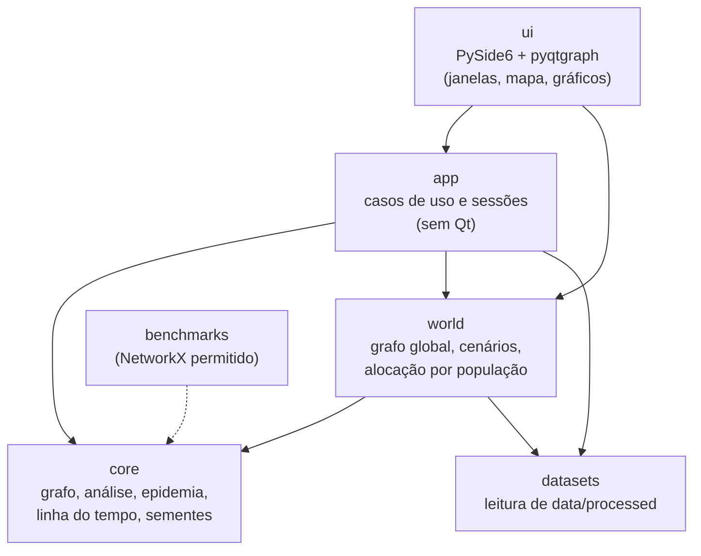
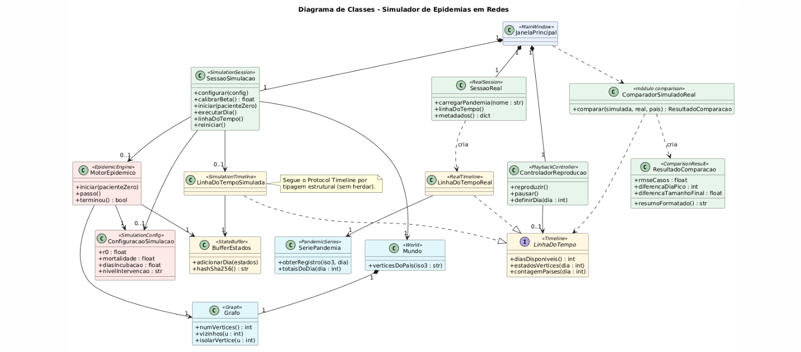
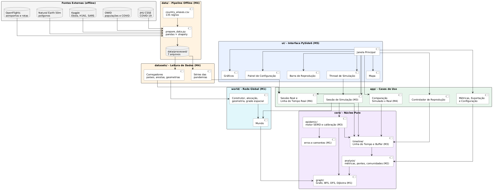
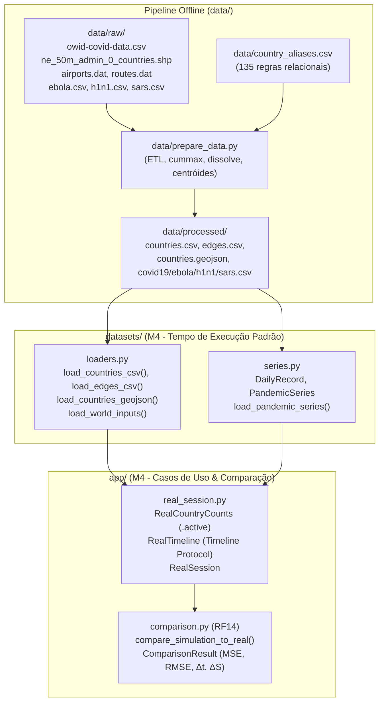

# Modelagem e Planejamento da Solução: Simulador de Epidemias em Redes

Trabalho Prático – Teoria dos Grafos (Tema 7)

*Documento Unificado de Planejamento e Modelagem – Versão 1.2 – 21/11/2026*  
*(Unificação integral dos documentos de `docs/planning-dev-docs/LLMFiles/`: `documento_apoio_simulador_epidemias.md` v0.8, `modelagem_simulador_epidemias.md` rev. 2, `dados_datasets_e_preparacao.md` v0.8, `arquitetura_simulador_epidemias.md` v0.6, `responsabilidades_modulos.md` v0.3, `setup_ambiente.md` v1.3, `implementation_plan_m4.md` / `guia_estudo_e_implementacao_M4.md` e `implementacao_M5.md`)*

---

## Sumário

1. [Contexto, Definição do Problema, Escopo e Decisões Gerais (`documento_apoio`)](#1-contexto-definição-do-problema-escopo-e-decisões-gerais)
2. [Requisitos Funcionais, Não Funcionais e Regras de Negócio (`documento_apoio`)](#2-requisitos-funcionais-não-funcionais-e-regras-de-negócio)
3. [Levantamento de Dados, Diagnóstico, Decisões D1–D25 e Script Offline (`dados_datasets_e_preparacao`)](#3-levantamento-de-dados-diagnóstico-decisões-d1d25-e-script-offline)
4. [Modelagem do Grafo Global Unificado e Justificativas (`modelagem`)](#4-modelagem-do-grafo-global-unificado-e-justificativas)
5. [Modelagem Epidemiológica SEIRD, Calibração, Intervenções e Comparação Real (`modelagem`)](#5-modelagem-epidemiológica-seird-calibração-intervenções-e-comparação-real)
6. [Algoritmos de Grafos, Complexidade, Validação e Limitações (`modelagem`)](#6-algoritmos-de-grafos-complexidade-validação-e-limitações)
7. [Arquitetura em Camadas, Contratos, Árvore de Pastas e Decisões A1–A19 (`arquitetura`)](#7-arquitetura-em-camadas-contratos-árvore-de-pastas-e-decisões-a1a19)
8. [Diagramas UML e Seção Reservada para Casos de Uso](#8-diagramas-uml-e-seção-reservada-para-casos-de-uso)
9. [Plano de Desenvolvimento, Responsabilidades M1–M5, Planos M4/M5 e Setup (`responsabilidades`, `M4`, `M5`, `setup`)](#9-plano-de-desenvolvimento-responsabilidades-m1m5-planos-m4m5-e-setup)

---

## 1. Contexto, Definição do Problema, Escopo e Decisões Gerais

*(Fonte unificada: `documento_apoio_simulador_epidemias.md` v0.8 — Seções 1, 2 e 3)*

### 1.1 Contexto e Enunciado
O trabalho prático pede uma ferramenta computacional que resolva um problema aplicado por meio da modelagem, implementação e análise de grafos, com interface de interação, avaliação dos resultados, análise de complexidade e discussão de limitações. O grupo escolheu o **Tema 7: Simulador de Epidemias em Redes**, isto é, representar uma rede de indivíduos (ou regiões) e simular a propagação de doenças, com ajuste de parâmetros como taxa de contágio, recuperação e isolamento.

**Restrições e entregas exigidas pelo enunciado:**
- **Prazo:** 22/11, até as 23:59, pelo Canvas (entrega individual por cada membro do grupo).
- **Pacote `.zip`:** código-fonte do trabalho, código-fonte do relatório (`.tex`) e PDF do relatório.
- **Relatório em LaTeX (template oficial da SBC):** entre 12 e 15 páginas, contextualizando a ideia, a modelagem (com diagramas UML), os resultados e as telas, indicando o que cada membro fez.
- **Repositório Git:** histórico de desenvolvimento com commits individuais avaliados.
- **Apresentação oral:** 10 minutos com demonstração e slides, com participação de todos os membros.
- **Vídeo demonstrativo:** 12 a 18 minutos mostrando o funcionamento e as *features* produzidas por cada aluno.
- **Restrição de bibliotecas:** é proibido usar bibliotecas prontas para criar e processar o grafo (como NetworkX), exceto para comparação de performance.

### 1.2 Problema e Objetivos
Entender como uma doença se espalha depende da estrutura de contatos entre as pessoas e do comportamento da própria doença. Redes com *hubs*, aglomerados e poucas conexões entre comunidades produzem epidemias muito diferentes, e medidas como isolamento e vacinação têm efeitos que variam conforme quem é isolado ou vacinado. A ferramenta torna esse comportamento visível e explorável:
- Simular a propagação de uma epidemia sobre um grafo, com parâmetros definidos pelo usuário antes de iniciar (**fluxo de simulação**), sobre o mesmo grafo global usado no fluxo de pandemias reais.
- Reproduzir visualmente pandemias reais a partir de *datasets* públicos (**fluxo de pandemias reais**), sobre o mesmo grafo global, com estados agregados por país.
- Aplicar e analisar algoritmos de grafos (busca, caminhos mínimos, centralidades, comunidades, pontes) no contexto da epidemia, com análise de complexidade.
- Apresentar tudo em uma aplicação desktop com visual inspirado no jogo *Plague Inc.* (a inspiração é apenas visual, não de comportamento).

### 1.3 Princípio de Funcionamento: Demonstrativo, Não Interativo
- O usuário configura o cenário antes de iniciar a simulação; depois, apenas assiste, sem alterar o rumo da epidemia.
- Os parâmetros ficam travados após o início; para mudar algo, reinicia-se (`RN01`).
- Os dois fluxos compartilham o mesmo grafo global (`RN05`); a diferença entre eles é apenas o cenário: demonstrativo (modelo epidemiológico) ou real (dados históricos).
- Os controles de reprodução (iniciar, pausar, velocidade, reiniciar) continuam disponíveis, pois não alteram a epidemia.
- Isolamento e vacinação são decididos pelo sistema, de forma aleatória e simulando comportamento realista, sem controle do usuário (`RN02`).
- O motor simula e grava o estado de cada vértice a cada passo, e a interface apenas reproduz com linha do tempo. Assim, os dois fluxos usam o mesmo player.

### 1.4 Dentro do Escopo, Fora do Escopo e Usuários
- **Dentro do escopo:** Aplicação desktop em Python com executável; estrutura de grafo e algoritmos próprios; grafo global de vértices agrupados por país com conexões geométricas internas e arestas entre países por rotas aéreas; modelo SEIRD com flags de isolado e vacinado e intervenções automáticas; quatro pandemias reais (COVID-19, Ebola, H1N1 e SARS); gráficos de resultados, métricas da rede e benchmark de desempenho.
- **Fora do escopo:** Previsão epidemiológica com validade científica ou uso em decisões reais de saúde pública (ferramenta didática); modelos de mobilidade detalhados; versão web ou mobile; alterar parâmetros ou escolher quem é isolado/vacinado após o início da simulação.
- **Usuários:** Estudantes e o professor avaliador.

### 1.5 Quadro de Decisões Gerais e Stack Tecnológica Confirmada

| Componente / Tema | Decisão Confirmada pelo Grupo |
|---|---|
| **Linguagem e Plataforma** | Python 3.12 (mesma versão para todos), aplicação desktop Windows em ambiente virtual (`venv`). |
| **Interface Gráfica e Mapa** | `PySide6` (Qt). Mapa GeoJSON (Natural Earth 50m) e vértices desenhados com `QPainter` em lote. |
| **Gráficos em Tempo Real** | `pyqtgraph` integrado à janela Qt. |
| **Núcleo do Grafo** | Estrutura própria (lista de adjacência + máscara de arestas ativas). NumPy liberado pelo professor (04/11/2026) e confinado a `buffer.py` e `engine.py`. NetworkX apenas em `benchmarks/`. |
| **Concorrência** | Simulação executada em thread separada (`QThread`), comunicando-se com a interface por sinais do Qt (`day_ready`). |
| **Empacotamento e Testes** | `PyInstaller` (`scripts/build_exe.ps1`); testes automatizados com `pytest` e lint com `ruff`. |
| **Idioma e Repositório** | Código e contratos em inglês; documentação em português (03/11/2026). Repositório público com dados processados sob ODbL 1.0 e brutos do Kaggle fora do Git. |

---

## 2. Requisitos Funcionais, Não Funcionais e Regras de Negócio

*(Fonte unificada: `documento_apoio_simulador_epidemias.md` v0.8 — Seção 4)*

### 2.1 Requisitos Funcionais — Fluxo de Simulação
| ID | Requisito | Prioridade | Módulo |
|---|---|---|---|
| **RF01** | Configurar, antes de iniciar, os parâmetros da doença: $R_0$ (a partir dele, o sistema calibra $\beta$), taxa total de saída de $I$ ($\gamma$), taxa de mortalidade (divide a saída de $I$ entre óbito e recuperação), período de incubação e nível de intervenção. Os parâmetros ficam travados após o início. | Essencial | M3, M5 |
| **RF02** | Gerar o grafo unificado: países com vértices proporcionais à população, conexões internas geométricas e arestas entre países por rotas aéreas, com semente configurável e tamanho definido por benchmark. | Essencial | M1 |
| **RF03** | Definir o(s) paciente(s) zero, de forma manual (clique no mapa ou país/vértice) ou aleatória. | Essencial | M3, M5 |
| **RF04** | Controlar a reprodução da simulação: iniciar, pausar, retomar, avançar um passo, reiniciar e ajustar a velocidade (controles que não alteram o rumo da epidemia). | Essencial | M3, M5 |
| **RF05** | Isolamento automático: o sistema isola vértices infectados de forma aleatória, simulando comportamento realista (probabilidade por passo e duração fixas, derivadas do nível configurado), sem controle do usuário sobre quem é isolado. Vale apenas para o fluxo de simulação. | Essencial | M3 |
| **RF06** | Vacinação automática: o sistema vacina, de forma aleatória, uma fração dos suscetíveis por passo a partir de um dia definido, conforme a configuração prévia. Vacinados passam a $R$ com a flag de vacinado. Vale apenas para o fluxo de simulação. | Desejável | M3 |
| **RF07** | Salvar e carregar a configuração de um cenário, em JSON (`app/config_io.py`). | Desejável | M5 |
| **RF08** | Exportar resultados da simulação: CSV (`app/export.py`) e imagem dos gráficos (`ui/charts_view.py`). | Desejável | M5 |
| **RF27** | Outros geradores de rede (Erdős–Rényi, Barabási–Albert, Watts–Strogatz) para as conexões internas de cada país, com seletor simples de nomes amigáveis. | Extra | M4 |

### 2.2 Requisitos Funcionais — Fluxo de Pandemias Reais
| ID | Requisito | Prioridade | Módulo |
|---|---|---|---|
| **RF09** | Selecionar a pandemia a visualizar entre as disponíveis (COVID-19, Ebola, H1N1, SARS). O carregamento dos dados é tarefa interna (`RNF10`), não ação do usuário. | Essencial | M4, M5 |
| **RF10** | Construir o grafo unificado a partir das rotas aéreas (arestas entre países ligando vértices dos dois países). | Essencial | M1 |
| **RF11** | Reproduzir a evolução temporal com linha do tempo (play, pausa e seleção de data). | Essencial | M5 |
| **RF12** | Exibir casos, mortes e recuperados por país no mapa (cor do polígono pela intensidade de casos por 100 mil habitantes) e em gráficos. | Essencial | M4, M5 |
| **RF13** | Montar o cenário global, para os dois fluxos (simulação e pandemias reais), com vértices por país proporcionais à população. | Essencial | M1 |
| **RF14** | Comparar a curva simulada pelo modelo com a curva real, agregando os estados dos vértices por país. Casos são comparados como $I + R + D$ (sem vacinados) e mortes como $D$; recuperados só no SARS. | Extra | M3, M4, M5 |

### 2.3 Requisitos Funcionais — Grafos, Análise e Interface
| ID | Requisito | Prioridade | Módulo |
|---|---|---|---|
| **RF15** | Estrutura própria de grafo com inserção e remoção de vértices e arestas, com pesos. | Essencial | M1 |
| **RF16** | Busca em largura e em profundidade; componentes conexos. | Essencial | M1 |
| **RF17** | Caminho mínimo (Dijkstra), por exemplo para tempo de chegada da doença entre regiões. | Essencial | M1 |
| **RF18** | Métricas de rede: grau, ao menos uma centralidade (intermediação ou proximidade) e coeficiente de agrupamento (local por vértice e média global). | Essencial | M2 |
| **RF19** | Detecção de comunidades por propagação de rótulos, com semente fixa para resultado reproduzível. | Desejável | M2 |
| **RF20** | Pontos de articulação e pontes (algoritmo de Tarjan, em uma única DFS). | Desejável | M2 |
| **RF21** | Painel de métricas da epidemia: percentual infectado, pico, duração, mortes e $R_0$ efetivo, estimado pelo crescimento inicial com a forma SEIR, $(1 + r/\sigma)(1 + r/\gamma)$. | Essencial | M2, M5 |
| **RF22** | Mapa com polígonos de países coloridos pelo status dominante (simulação) ou pela intensidade de casos (pandemias reais), e vértices exibidos a partir de 40 px de largura do país na tela e ocultados abaixo de 36 px. | Essencial | M5 |
| **RF23** | Painel de controles com campos e sliders para os parâmetros. | Essencial | M5 |
| **RF24** | Gráficos em tempo real das curvas $S, E, I, R$ e $D$. | Essencial | M5 |
| **RF25** | Tela inicial para escolher entre os dois fluxos. | Essencial | M5 |
| **RF26** | Zoom e pan no mapa; inspeção de vértice (estado e métricas). | Desejável | M5 |

### 2.4 Requisitos Não Funcionais e Regras de Negócio
| ID | Especificação | Prioridade / Tipo |
|---|---|---|
| **RNF01** | Implementação em Python 3.12 com PySide6, aplicação desktop, sem bibliotecas prontas de grafos (exceto no benchmark). | Essencial |
| **RNF02** | Animação fluida (cerca de 5–8 mil vértices a pelo menos 20 quadros por segundo). | Essencial |
| **RNF03** | Interface responsiva: a simulação roda em thread separada da interface. | Essencial |
| **RNF04** | Geração de executável com PyInstaller (Nuitka como alternativa), para o SO do grupo (Windows). | Essencial |
| **RNF05** | Reprodutibilidade: semente aleatória configurável; mesma semente e mesmos parâmetros dão o mesmo resultado. | Essencial |
| **RNF06** | Código modular em camadas, com testes unitários do núcleo do grafo e dos algoritmos. | Essencial |
| **RNF07** | Git com commits individuais e frequentes por membro. | Essencial |
| **RNF08** | Mensagens de erro claras (por exemplo, dataset inválido ou parâmetro fora da faixa). | Desejável |
| **RNF09** | Análise de complexidade dos algoritmos e comparação de desempenho documentadas para o relatório. | Essencial |
| **RNF10** | Dados pré-processados: o aplicativo só lê arquivos já processados em `data/processed/`. | Essencial |
| **RN01** | Os parâmetros ficam travados após o início da simulação; para alterá-los, é preciso reiniciar. | Regra de Negócio |
| **RN02** | Isolamento e vacinação existem apenas no fluxo de simulação. No fluxo real, os dados já refletem as medidas da época. | Regra de Negócio |
| **RN03** | Com a mesma semente e os mesmos parâmetros, a simulação produz o mesmo resultado. | Regra de Negócio |
| **RN04** | No fluxo de pandemias reais, a animação reproduz os dados reais agregados por país; o modelo só entra na comparação opcional (`RF14`). | Regra de Negócio |
| **RN05** | Os dois fluxos usam o mesmo grafo; a diferença é o cenário. | Regra de Negócio |

---

## 3. Levantamento de Dados, Diagnóstico, Decisões D1–D25 e Script Offline

*(Fonte unificada: `dados_datasets_e_preparacao.md` v0.8 — Seções 1 a 9)*

### 3.1 Visão Geral e Arquivos do Núcleo, Opcionais e Descartados
O fluxo de pandemias reais requer três tipos de dado cruzados exclusivamente pela chave **ISO3**: (1) **Fatos** (casos, mortes e recuperados por país/dia); (2) **Tabela mestra de países** (ISO3, nome, população, atributos estáticos e centroide); (3) **Arestas** (rotas aéreas internacionais).

- **Arquivos obrigatórios do núcleo:**
  - **COVID-19 (JHU CSSE / Kaggle):** `RAW_global_confirmed_cases.csv`, `RAW_global_deaths.csv` (22/01/2020 a 09/03/2023; CC BY 4.0 — citar Dong, Du & Gardner, 2020).
  - **Ebola 2014–2016:** `ebola_2014_2016_clean.csv` (29/08/2014 a 23/03/2016).
  - **H1N1 2009:** `data.csv` (24/04/2009 a 06/07/2009).
  - **SARS 2003:** `sars_2003_complete_dataset_clean.csv` (17/03/2003 a 11/07/2003 — único com recuperados).
  - **OWID:** `owid-covid-data.csv` (tabela mestra de países e população; CC BY 4.0; não entra no aplicativo).
  - **OpenFlights:** `airports.dat`, `routes.dat`, `countries.dat` (ODbL 1.0 e DbCL).
  - **Natural Earth:** Admin 0 – Countries, 50m, v5.1.1 (242 feições; domínio público; convertido uma vez de shapefile para GeoJSON `ne_50m_admin_0_countries.json`).
- **Arquivos opcionais:** `summary_data_clean.csv` (SARS, casos importados), `summary_south_america.csv` (H1N1), `RAW_us_*` (COVID por condado nos EUA).
- **Arquivos descartados:** `CONVENIENT_*`, `ebola_data_db_format.csv`, `summary_*` regionais do H1N1 sem série temporal, dataset de HIV/AIDS (não é série de propagação diária) e feições do Natural Earth sem entidade no modelo (`ATA`, `ATF`, `HMD`, `NFK`, `SGS`, `IOT`, `SOL`, `KAS`).

### 3.2 Diagnóstico Detalhado dos Datasets Brutos
- **COVID-19 (JHU):** Formato largo (289 linhas, 201 países); 8 países divididos em províncias que precisam ser somadas (China 34, Canadá 16, Reino Unido 15, França 12, Austrália 8, Holanda 5, Dinamarca 3, Nova Zelândia 3); linhas não-países (`Diamond Princess`, `MS Zaandam`, `Summer Olympics 2020`, `Winter Olympics 2022`, `Antarctica`); 362 quedas retroativas nos acumulados; sem população e sem recuperados.
- **Ebola:** 10 países (Guiné, Libéria e Serra Leoa concentram os casos; demais são Nigéria, EUA, Mali, Senegal, Espanha, Reino Unido, Itália); lacunas de até 85 dias; quedas nos acumulados; Libéria mistura duas séries (365 linhas para 259 datas: a principal termina com 10.666 casos e 4.806 mortes, enquanto `Liberia 2` termina com 9 casos e 3 mortes); 4 nulos em Reino Unido e Mali.
- **H1N1:** 148 países, 50 datas, intervalos de até 3 dias; 36 nomes não casam com o OWID (ex.: `Bosnia and Hezegovina`, `Cap Verde`, `UK`, `Bermuda, UKOT`, `French Polynesia, FOC`); múltiplas grafias para o mesmo território (`France, Martinique, FOC` e `Martinique, FOC`; três grafias para Curaçao); quedas nos acumulados em 5 países.
- **SARS:** 37 países, 96 datas; **duplicata na China em 12/04/2003** com 1.309 casos vs. 62 casos (mantém-se 1.309 e descarta-se 62); quedas em 18 países (casos) e 12 (recuperados); divergência `Taiwan, China` vs. `Taiwan`.
- **OWID e Universo de 229 Entidades:** 237 países com continente preenchido + Kosovo (`OWID_KOS`, única exceção ao descarte de prefixo `OWID_`) $-$ 8 territórios sem polígono próprio no Natural Earth 50m (`GIB` $\to$ `GBR`; `BES` $\to$ `NLD`; `TKL` $\to$ `NZL`; `GLP`, `GUF`, `MTQ`, `MYT`, `REU` $\to$ `FRA`) $-$ Norte do Chipre (`OWID_CYN`, somado a `CYP`) $= \mathbf{229\text{ entidades}}$.
- **OpenFlights:** 7.698 aeroportos e 67.663 rotas; 220 rotas sem ID de origem, 221 sem destino e 523 apontando para aeroportos ausentes; exceções de aeroportos (`iata:PRN` Pristina $\to$ `KOS`; `BON`, `EUX`, `SAB` $\to$ `BES` $\to$ `NLD`; `CUR` $\to$ `CUW`; `SXM` $\to$ `SXM`).

### 3.3 Tabela Completa de Decisões de Dados (`D1` a `D25`)

| # | Tema | Decisão |
|---|---|---|
| **D1** | Séries de COVID | Usar JHU (`RAW_global_*`); OWID só para a tabela mestra. |
| **D2** | Arquivos | Usar só as fontes do núcleo (seção 3.1); demais opcionais ou descartados. |
| **D3** | Fonte das arestas | OpenFlights (rotas aéreas), não fronteiras terrestres. |
| **D4** | Chave de cruzamento | ISO3 em todas as fontes. |
| **D5** | Onde normalizar | Fora do aplicativo, por script rodado uma vez por quem prepara os dados. |
| **D6** | Conteúdo do repositório | Aplicativo lê só `data/processed/`; brutos fora do repositório; script e tabela de apelidos versionados. |
| **D7** | Execução do script | Uma vez pelo responsável pelo M4, com saída versionada no Git. O aplicativo nunca roda o script. |
| **D8** | Não-países | Descartar `Diamond Princess`, `MS Zaandam`, Olimpíadas, Antártida e feições `ATA, ATF, HMD, NFK, SGS, IOT, SOL, KAS`. |
| **D9** | Territórios sem polígono próprio | Agregar ao país-mãe: `GIB` $\to$ `GBR`; `BES` $\to$ `NLD`; `TKL` $\to$ `NZL`; `GLP, GUF, MTQ, MYT, REU` $\to$ `FRA` (somando casos, mortes e população; rotas entre território e metrópole viram domésticas e saem). |
| **D10** | Acumulados com quedas | Aplicar máximo acumulado (`cummax`) por entidade de origem (`D21`). |
| **D11** | Datas faltantes | Série diária contínua: preencher com o último valor anterior; antes do primeiro registro, zero. |
| **D12** | Recuperados | Coluna vazia onde não existe (COVID, Ebola, H1N1); preenchida só no SARS. |
| **D13** | Peso e direção das arestas | Não dirigido. `edges.csv` guarda o número bruto de rotas (`routes`). Transformação em peso e custo é feita pelo aplicativo. |
| **D14** | Rotas em codeshare | Excluir `codeshare = Y` para não contar o mesmo voo duas vezes. |
| **D15** | Coordenadas dos países | Polígonos do Natural Earth 50m (chave `ISO_A3_EH` com fallback em `ADM0_A3`); `ALA` agregada à `FIN` e `CYN` ao `CYP`; tratamento do antimeridiano (+360° em longitudes negativas no cálculo de centroide para Rússia, Fiji, EUA, Kiribati e Nova Zelândia). |
| **D16** | Países sem nenhuma rota | Manter isolados e exibir aviso na interface, sem criar arestas artificiais. |
| **D17** | NumPy no núcleo | Liberado pelo professor em 04/11/2026; não afeta o script de dados. |
| **D18** | Multiplicidade das arestas | `k_ij = min(k_max, ceil(routes_ij / escala))` arestas entre vértices sorteados com semente fixa, herdando peso `w_ij`. |
| **D19** | Kosovo | Entra no modelo (`OWID_KOS` / `KOS`) com `iso3 = KOS`. Única exceção aos códigos `OWID_`. |
| **D20** | Geometria processada | `countries.geojson` com uma feição (`Polygon` ou `MultiPolygon`) por entidade (229), lida pela stdlib no app. |
| **D21** | Ordem de agregação | Preencher datas e aplicar `cummax` em cada entidade de origem (resolvida pelo apelido) antes de somar no país-mãe. |
| **D22** | Libéria no Ebola | Manter em cada data a linha de maior `cases` (série principal) e descartar `Liberia 2`. |
| **D23** | Duplicata da China no SARS | Em 12/04/2003, manter o registro de 1.309 casos e descartar o de 62 casos. |
| **D24** | Norte do Chipre | Somar população de `OWID_CYN` (382.836) à de `CYP` e excluir `OWID_CYN` das 229 entidades. |
| **D25** | Repositório público e licenças | Repositório público; `data/processed/` licenciado sob ODbL 1.0 (`data/LICENSE-ODbL.txt`); brutos do Kaggle fora do Git. |

### 3.4 Esquemas dos Arquivos Processados e Especificação de `prepare_data.py`
- **`countries.csv` (229 linhas):** `iso3, name, continent, population, population_density, median_age, gdp_per_capita, hospital_beds_per_thousand, life_expectancy, human_development_index, lat, lon`.
- **`covid19.csv`, `ebola.csv`, `h1n1.csv`, `sars.csv`:** `iso3, date, cases, deaths, recovered` (`date` em `AAAA-MM-DD`, contínua e sem lacunas; valores inteiros não decrescentes).
- **`edges.csv`:** `iso3_a, iso3_b, routes` com `iso3_a < iso3_b` e `routes > 0` (sem auto-laços).
- **`country_aliases.csv`:** `alias, iso3, parent_iso3, note` (135 regras relacionais, incluindo prefixos `iata:` e valor `DROP`).
- **`countries.geojson`:** 229 feições com propriedade `iso3` idêntica à de `countries.csv` (~1,4 a 1,6 MB).
- **Interface do script (`prepare_data.py`):** `python data/prepare_data.py --raw <pasta_brutos> --out data/processed` (usa `pandas` e `shapely` em ambiente `.venv-data` separado; falha ruidosamente se houver qualquer nome sem resolução ou violação de validação).

---

## 4. Modelagem do Grafo Global Unificado e Justificativas

*(Fonte unificada: `modelagem_simulador_epidemias.md` rev. 2 — Seções 1, 2 e 10)*

### 4.1 Grafo Unificado Não Direcionado
Os dois fluxos usam o mesmo grafo global não direcionado. Cada país é representado por um conjunto de vértices (indivíduos) em quantidade proporcional à população; dentro de cada país os vértices se conectam por proximidade geométrica, e entre países as arestas vêm das rotas aéreas do OpenFlights.
- **Justificativa:** A comparação com dados reais exige a mesma granularidade, e um único motor reduz código, testes e erros. O grafo é não direcionado porque contato e transporte são de via dupla (as rotas $A \to B$ e $B \to A$ são somadas em um único par não ordenado).

### 4.2 Alocação Iterativa de Vértices por País (Cenário Global e Regional)
Para cada país $i$ com população $p_i$:
$$n_i \propto p_i^\alpha, \quad \text{com soma igual a } N_{\text{total}}$$
- **Parâmetros:** $N_{\text{total}} = 8.000$ (provisório, a confirmar por benchmark visual `RNF02`), $n_{\min} = 12$ (decidido) e $\alpha = 0{,}5$ (decidido).
- **Procedimento iterativo para orçamento fixo:** Como `max(n_min, ...)` faria a soma exceder $N_{\text{total}}$, o algoritmo: (1) calcula a cota proporcional sobre o orçamento restante entre os países livres; (2) fixa em $n_{\min}$ os países cuja parcela ficou abaixo de $n_{\min}$ e subtrai esse valor do orçamento; (3) repete até que nenhum país livre fique abaixo do piso; (4) arredonda pelo **método do maior resto** para que a soma seja exatamente $N_{\text{total}}$.
- **Cenário Regional (Ebola — Seção 10):** O orçamento de vértices é redistribuído para os países que atingem 10 casos acumulados nos primeiros 60 dias a partir do dia 0 do surto (prazo configurável; resultado esperado: Guiné, Libéria e Serra Leoa). Os demais países ficam no piso $n_{\min} = 12$, preservando o grafo global unificado.

### 4.3 Conexões Internas (Rede Geométrica Aleatória e Grade Espacial)
Os vértices de cada país são sorteados dentro do polígono do país (Natural Earth 50m) e conectam-se quando a distância é menor que o raio $r$:
$$r \approx \sqrt{\frac{\bar{d}}{\pi \cdot \rho}}$$
onde $\rho$ é a densidade de vértices do país e $\bar{d}$ está entre 6 e 10 (a definir por benchmark). Para países no piso, o grau médio efetivo é $\bar{d}_{\text{ef}} = \min(\bar{d}, n_i - 1)$. A busca de vizinhos utiliza **grade espacial** para evitar comparar todos os pares.
- **Justificativa:** Um raio fixo faria o grau médio variar com a densidade territorial, tornando países grandes e pequenos estruturalmente diferentes.

### 4.4 Arestas Internacionais, Pesos, Probabilidade de Contágio e Custo de Caminho
Para cada par de países $(i, j)$ com $\text{routes}_{ij}$ rotas válidas no OpenFlights:
- **Multiplicidade:**
  $$k_{ij} = \min\bigl(k_{\max}, \lceil \text{routes}_{ij} / \text{escala} \rceil\bigr)$$
  Cada uma das $k_{ij}$ arestas liga dois vértices escolhidos uniformemente ao acaso (um em cada país, com semente fixa) e herda o peso normalizado $w_{ij}$.
- **Peso normalizado:**
  $$w_{ij} = \frac{\ln(1 + \text{routes}_{ij})}{\ln(1 + \max \text{routes})}$$
- **Probabilidade de transmissão por aresta e custo para Dijkstra (Brockmann & Helbing, 2013):**
  $$p_{ij} = 1 - \exp(-\beta \cdot w_{ij}), \qquad \text{custo}_{ij} = -\ln(p_{ij})\quad (\text{com } p \text{ limitado a } 0{,}999)$$
- **Justificativa:** O número de arestas cresce com o tráfego até um teto, e o logaritmo reduz o domínio dos pares de altíssimo tráfego. Usar `routes` diretamente como custo no Dijkstra inverteria a semântica; com $-\ln(p_{ij})$, os custos são não negativos e somar custos equivale a multiplicar probabilidades.

---

## 5. Modelagem Epidemiológica SEIRD, Calibração, Intervenções e Comparação Real

*(Fonte unificada: `modelagem_simulador_epidemias.md` rev. 2 — Seções 2.6, 4, 5, 6 e 7)*

### 5.1 Estados, Flags e Transições Diárias
Cinco estados epidemiológicos (**S, E, I, R, D**) e dois atributos booleanos ortogonais:
- **Isolado (flag no bit 3):** independente do estado; um vértice pode estar $I$ e isolado simultaneamente.
- **Vacinado (flag no bit 4):** vacinados passam ao estado $R$ e recebem a flag de vacinado, distinguindo-os do $R$ natural.
- **Leis de transição por passo (1 passo = 1 dia):**
  $$P(E \to I) = 1 - \exp(-\sigma), \qquad P(\text{saída de } I) = 1 - \exp(-\gamma)$$
  onde $\sigma = 1/\text{incubação}$ e $\gamma$ é a taxa total de saída de $I$. Cada saída de $I$ vai para $D$ (absorvente) com probabilidade igual à mortalidade definida pelo usuário, e para $R$ natural com a probabilidade complementar.

### 5.2 Calibração de $\beta$ por Bisseção e Verificação de Newman
O usuário informa o $R_0$ (`RF01`). Antes de iniciar, o sistema gera o grafo, roda simulações curtas com valores de teste de $\beta$ e ajusta $\beta$ por **bisseção** até o $R_0$ medido ficar próximo do informado. A fórmula analítica de Newman para redes, $R_0 \approx T \cdot (\langle k^2 \rangle / \langle k \rangle - 1)$, serve como verificação. As funções de probabilidade e custo recebem $\beta$ como argumento e são chamadas pelo M3 depois da calibração (`A16`).

### 5.3 Isolamento, Vacinação e Tabela de Níveis de Intervenção
- **Isolamento (`RF05`):** A cada passo, cada vértice em $I$ tem probabilidade de se isolar conforme o nível; a máscara de arestas do vértice fica inativa pela duração do isolamento sem alterar a estrutura do grafo e, ao fim do período, o vértice volta com as mesmas arestas. Isolado não contamina nem é contaminado, mas pode morrer.
- **Vacinação (`RF06`):** A partir do dia de início do nível, uma fração diária dos suscetíveis ($S$) é vacinada, passando para $R$ (com flag de vacinado) com probabilidade igual à eficácia fixa de $0{,}8$ (se falhar, permanece em $S$).

| Nível | Isolamento (prob. diária, duração) | Vacinação (dia de início, fração diária) | Eficácia |
|---|---|---|---|
| **Baixo** | $0{,}05$ e $7\text{ dias}$ | dia $180$, $0{,}2\%$ | $0{,}8$ (fixa) |
| **Médio** | $0{,}15$ e $10\text{ dias}$ | dia $120$, $0{,}5\%$ | $0{,}8$ (fixa) |
| **Alto** | $0{,}30$ e $14\text{ dias}$ | dia $60$, $1{,}0\%$ | $0{,}8$ (fixa) |

*(Valores validados por teste de sensibilidade no M3, demonstrando redução monotônica no total de casos acumulados).*

### 5.4 Calibração Inicial nos Datasets (H1N1 e SARS)
- **H1N1 (`data.csv`, trecho de 08/05 a 05/06/2009, 2.501 a 22.027 casos):** $r \approx 0{,}078\text{/dia}$. Com $R_0 = (1 + r/\sigma)(1 + r/\gamma)$ e incubação de $1{,}4\text{ dias}$ ($\sigma \approx 0{,}71$, Lessler et al., 2009): para $R_0 = 1{,}5$, $\gamma \approx 0{,}22\text{/dia}$ (infecciosidade ~4,5 dias); para a faixa $R_0 \in [1{,}4; 1{,}6]$ (Fraser et al., 2009), $\gamma \in [0{,}18; 0{,}30]\text{/dia}$. Letalidade observada ~0,45%.
- **SARS (`sars_2003_complete_dataset_clean.csv`, trecho de 31/03 a 14/04/2003, 1.634 a 3.186 casos):** $r \approx 0{,}048\text{/dia}$. Com incubação de $4{,}0\text{ dias}$ ($\sigma = 0{,}25$, Lessler et al., 2009) e $R_0 = 3$ (Lipsitch et al., 2003), $\gamma \approx 0{,}032\text{/dia}$ (~31 dias); com incubação de $6{,}4\text{ dias}$ (Donnelly et al., 2003), $\gamma \approx 0{,}037\text{/dia}$; na faixa $R_0 \in [2; 4]$, $\gamma \in [0{,}020; 0{,}071]\text{/dia}$. Letalidade observada ~9,4%.

### 5.5 Comparação com Dados Reais e Regra de Cor no Fluxo Real
- **Quantidades comparadas:** Casos acumulados simulados $= I + R + D$ sem vacinados (exclui $E$); mortes acumuladas $= D$; recuperados acumulados $= R$ sem vacinados (só no SARS).
- **Dia 0 por país (decidido em 14/11/2026):** Primeiro dia em que o número de vértices com casos do país atinge $M$ ($M = 1$ padrão configurável). No fluxo real, o mesmo $M$ é convertido em casos pela razão populacional: $\max(1, \lfloor M \times \text{população}_i / n_i \rfloor)$.
- **Métricas de comparação (`RF14`, implementadas em `app/comparison.py`):** (1) Erro quadrático médio (MSE e RMSE) entre curvas normalizadas pela população no intervalo comum $T_{\text{comum}}$; (2) Diferença de dia do pico ($\Delta t_{\text{pico}}$) e magnitude de pico ($\Delta \text{PeakMag}$) medidas por **novos casos por dia**; (3) Diferença do tamanho final da epidemia ($\Delta S_\infty$).
- **Regra de cor no fluxo real (`A12`):** Polígono de cada país pintado pela intensidade de casos acumulados por 100 mil habitantes em escala sequencial a partir de 10 por 100 mil (0,01% da população), evitando que países com $R = 0$ (COVID, Ebola, H1N1) fiquem permanentemente na cor de $I$.

---

## 6. Algoritmos de Grafos, Complexidade, Validação e Limitações

*(Fonte unificada: `modelagem_simulador_epidemias.md` rev. 2 — Seções 8, 9, 11, 12 e 13)*

### 6.1 Tabela de Algoritmos e Complexidade
| Algoritmo | Uso no Simulador | Grafo | Complexidade |
|---|---|---|---|
| **Busca em largura (BFS) e profundidade (DFS)** | Componentes conexos; tempo de chegada em saltos | Completo | $O(V + E)$ |
| **Dijkstra** | Tempo esperado de chegada entre países, com custo $-\ln(p)$ | Completo ou contraído | $O((V + E) \log V)$ |
| **Tarjan (pontes e articulações)** | Arestas e vértices críticos | Completo | $O(V + E)$, em uma DFS |
| **Propagação de rótulos** | Comunidades entre países (com semente fixa) | Contraído por país | Quase linear |
| **Grau** | Métrica no painel | Completo | $O(V + E)$ |
| **Coeficiente de agrupamento** | Métrica de rede (`RF18`): local por vértice e média global | Completo | $O(\sum k_v^2)$ com conjuntos de vizinhança |
| **Intermediação aproximada (Brandes)** | Análise de centralidade por amostragem de $k$ fontes | Completo | $O(k \cdot (V + E))$ |
| **Intermediação exata (Brandes)** | Só no benchmark | Completo | $O(V \cdot E)$ |
| **Grade espacial** | Criação das arestas geométricas internas por país | Vértices por país | Quase linear $O(V + E)$, em vez de $O(V^2)$ |
| **Passo diário da simulação (`step`)** | Iteração síncrona sobre vizinhos ativos e transições SEIRD | Completo (arestas ativas) | $O(V + E)$ ativas |

### 6.2 Validação Científica, Reprodutibilidade e Benchmark
- **Casos de referência (`11.1`):**
  1. *Grafo completo, sem isolamento nem vacinação:* a dinâmica deve aproximar a solução numérica de campo médio dentro de $5\%$ no pico de infectados.
  2. *Grafo sem arestas:* nenhuma propagação além do paciente zero.
  3. *Grafos pequenos com resposta conhecida:* caminho (todas as arestas são pontes no Tarjan), ciclo (nenhuma ponte) e caminho mínimo calculado à mão (Dijkstra).
- **Invariante de conservação (`11.2`):** Em todo passo, $S + E + I + R + D = N$, por país e no total.
- **Política de sementes (`11.3`):** Uma semente global fornecida pelo usuário; cada subsistema (`rede`, `paciente_zero`, `isolamento`, `vacinacao`, `rotulos`, `calibracao`) deriva sua semente determinística via `hashlib` e usa gerador próprio. Mesma semente e mesmos parâmetros geram o mesmo buffer (verificado por hash SHA-256).
- **Benchmark (`11.4`):** NetworkX permitido exclusivamente em `benchmarks/`; tamanhos de referência de 1 mil, 5 mil, 10 mil e 50 mil vértices; meta visual de $\ge 20\text{ FPS}$ com ~5–8 mil vértices.

### 6.3 Limitações Registradas do Modelo
1. **Dados de rotas desatualizados:** OpenFlights encerrou atualização em junho de 2014 (retrato estático aplicado às 4 pandemias).
2. **População de um único ano:** população do OWID (~2022) usada também para 2003, 2009 e 2014–2016.
3. **Fronteiras de fato:** o Natural Earth traça fronteiras de fato (controle territorial), não de direito.
4. **Países sem rota:** permanecem sem conexão aérea internacional.
5. **Isolado não é contaminado:** a máscara bloqueia todas as arestas do vértice, não capturando contágio intradomiciliar.
6. **Isolamento e vacinação sem fonte nos dados:** os níveis são premissas didáticas do modelo, avaliadas por sensibilidade.
7. **Tempo de geração do H1N1:** Fraser et al. (2009) estimam 1,9 dias, enquanto a infecciosidade derivada pelo crescimento inicial é ~4,5 dias.
8. **Recuperados do SARS com atraso e subnotificação empírica:** os registros históricos refletem casos confirmados laboratorialmente e atrasos de notificação.
9. **Escala reduzida e conectividade interna geométrica:** 8 mil vértices representam milhões de habitantes (comparação por frações) e o grafo geométrico interno é uma aproximação espacial, não mobilidade real.

---

## 7. Arquitetura em Camadas, Contratos, Árvore de Pastas e Decisões A1–A19

*(Fonte unificada: `arquitetura_simulador_epidemias.md` v0.6 — Seções 1 a 10)*

### 7.1 Princípios e Visão em Camadas (Diagrama Original da Arquitetura)
Cinco princípios governam a arquitetura: (1) **Núcleo sem interface**; (2) **Uma única fonte de verdade para a reprodução (`Timeline`)**; (3) **Configuração congelada (`SimulationConfig`)**; (4) **Determinismo por subsistema (`SeedBook`)**; (5) **Dependências em uma única direção**.



| Camada | Responsabilidade | Pode importar | Não pode importar |
|---|---|---|---|
| `core` | Estruturas e algoritmos de grafo; modelo epidemiológico; buffer de estados; sementes | biblioteca padrão (e NumPy apenas em `buffer.py` e `engine.py`) | Qt, pyqtgraph, pandas, NetworkX, camadas acima |
| `world` | Construção do grafo unificado: alocação de vértices, posições, conexões geométricas, arestas por rotas, cenários | `core`, `datasets` | Qt, `app`, `ui` |
| `datasets` | Leitura dos arquivos já processados em `data/processed/` (CSV e GeoJSON) | biblioteca padrão | Qt, pandas, camadas acima |
| `app` | Casos de uso: sessão de simulação, sessão de pandemia real, controle de reprodução, métricas do painel, configuração e exportação | `core`, `world`, `datasets` | Qt, `ui` |
| `ui` | Janelas, tela inicial, painel de controles, mapa com QPainter, gráficos com pyqtgraph, thread de simulação | tudo acima, PySide6, pyqtgraph | (nenhuma restrição interna além da regra de dependência) |

### 7.2 Contratos entre Camadas e Regras de Renderização do Mapa

```python
class Timeline(Protocol):
    """Histórico de estados já disponível para reprodução."""
    num_vertices: int                 # total de vértices do grafo global
    vertex_country: Sequence[int]     # índice do país de cada vértice
    countries: Sequence[CountryInfo]  # nome, ISO3, população, geometria

    @property
    def days_available(self) -> int: ...

    def vertex_states(self, day: int) -> bytes | None: ...
    def country_counts(self, day: int) -> Sequence[CountryCounts]: ...
```

```python
class EpidemicEngine:
    def __init__(self, world: World, config: SimulationConfig, seeds: SeedBook,
                 buffer: StateBuffer) -> None: ...
    def start(self, patient_zero: Sequence[int] | None) -> DayRecord: ...
    def step(self) -> DayRecord: ...
    @property
    def finished(self) -> bool: ...
```

```python
class SimulationSession:
    """Cenário configurado, motor e buffer. Sem Qt."""
    config: SimulationConfig      # congelado após start()
    def configure(self, config: SimulationConfig) -> None: ...
    def calibrate_beta(self) -> float: ...
    def start(self, patient_zero: Sequence[int] | None = None) -> DayRecord: ...
    def run_day(self) -> DayRecord: ...
    def timeline(self) -> Timeline: ...
    def reset(self) -> None: ...
```

```python
@dataclass(frozen=True)
class SimulationConfig:
    seed: int = 42
    scenario: str = "global"              # "global" ou "regional_ebola"
    r0: float = 2.5                       # R0 informado pelo usuário; β é calibrado a partir dele
    exit_rate_gamma: float = 0.1          # taxa total de saída de I (γ), informada pelo usuário
    mortality: float = 0.02               # fração das saídas de I que vão para D
    incubation_days: float = 4.0          # sigma = 1 / incubation_days
    intervention_level: str = "baixo"     # "nenhum", "baixo", "medio", "alto"
    patient_zero: tuple[int, ...] | None = None
    max_days: int = 365
    day_zero_threshold_m: int = 1
```

**Limiares de renderização do mapa em duas camadas (`RF22`):**

| Parâmetro | Valor inicial | Justificativa |
|---|---|---|
| Limiar de entrada (mostrar vértices) | `40 px` | Com 12 vértices ($n_{\min}$) e marcador de 3 px, 40 px dão espaçamento médio ~10 px sem sobreposição. |
| Limiar de saída (ocultar vértices) | `36 px` | Histerese de 4 px para evitar piscar quando o zoom oscila em torno do limiar. |
| Diâmetro do marcador | `3 px` | Legível sem cobrir o polígono. |

### 7.3 Estrutura de Pastas do Repositório

```text
simulador-epidemias/
├── .github/workflows/ci.yml
├── .vscode/
├── benchmarks/                       # único lugar em que NetworkX é permitido
│   ├── README.md
│   └── bench_grafo.py
├── data/                             # preparação offline (fora do aplicativo)
│   ├── README.md
│   ├── LICENSE-ODbL.txt
│   ├── country_aliases.csv
│   ├── prepare_data.py
│   ├── requirements-data.txt
│   └── processed/                    # único conteúdo de dados que o app lê (versionado)
├── docs/
├── scripts/
│   └── build_exe.ps1
├── src/epidemia/
│   ├── __init__.py
│   ├── main.py
│   ├── config.py
│   ├── core/                         # domínio puro, sem Qt
│   │   ├── errors.py
│   │   ├── seeds.py
│   │   ├── graph/                    # graph.py, weights.py, traversal.py, shortest_path.py
│   │   ├── analysis/                 # metrics.py, communities.py, bridges.py, epidemic_metrics.py
│   │   ├── epidemic/                 # parameters.py, calibration.py, model.py, interventions.py, engine.py
│   │   └── timeline/                 # protocol.py, buffer.py
│   ├── world/                        # world.py, allocation.py, geometry.py, spatial_grid.py, builder.py, scenarios.py
│   ├── datasets/                     # loaders.py, series.py
│   ├── app/                          # simulation_session.py, real_session.py, comparison.py, playback.py, panel_metrics.py, config_io.py, export.py
│   └── ui/                           # main_window.py, start_screen.py, config_panel.py, map_view.py, charts_view.py, player_bar.py, simulation_thread.py, styles.py
└── tests/                            # architecture/, core/, world/, datasets/, app/, ui/
```

### 7.4 Tabela Completa de Decisões Arquiteturais (`A1` a `A19`)

| # | Decisão | Motivo |
|---|---|---|
| **A1** | Quatro camadas (`core`, `world`/`datasets`, `app`, `ui`) com dependência em uma direção | Permite testar o domínio sem janela e dividir o trabalho entre membros. |
| **A2** | `Timeline` como interface única de reprodução para os dois fluxos | Um só player para simulação e dados reais. |
| **A3** | `SimulationConfig` imutável | Garante `RN01` por construção, não por disciplina. |
| **A4** | Sementes derivadas por `hashlib`, nunca por `hash()` | `hash()` do Python varia entre execuções; `hashlib` garante `RN03`. |
| **A5** | Buffer somente de acréscimo (*append-only*), anunciado por sinal | Leitura segura entre thread e interface sem travas complexas. |
| **A6** | Regras de dependência verificadas por teste automático (`test_camadas.py`) | Evita que a interface vaze para o domínio. |
| **A7** | Pacote `datasets/` lê só `data/processed/` com `csv` e `json` da stdlib | `pandas` fica fora do aplicativo. |
| **A8** | `benchmarks/` fora de `src/` | NetworkX só no benchmark. |
| **A9** | Pacote de dados renomeado para `datasets/`; nomes de código em inglês | Evita confusão com `data/`; convenção fechada em 03/11. |
| **A10** | Flags de isolado e vacinado no byte de cada vértice (bits 3 e 4) | Permite comparar $R$ sem vacinados com os dados reais. |
| **A11** | Entrada do Natural Earth em GeoJSON, lida pela biblioteca padrão | Elimina `pyshp` e mantém o aplicativo sem dependências de geometria. |
| **A12** | Regra de cor do fluxo real por intensidade de casos por 100 mil hab. | Evita que o país fique sempre na cor de $I$ quando $R = 0$. |
| **A13** | Módulos `app/config_io.py` (`RF07`) e `app/export.py` (`RF08`) + imagem em `ui/charts_view.py` | Cobertura explícita dos requisitos de persistência e exportação. |
| **A14** | Cálculo de $\beta$ por bisseção antes do início, em `core/epidemic/calibration.py` | Torna o $R_0$ informado pelo usuário efetivo no grafo gerado. |
| **A15** | M1 possui `world/`, `core/seeds.py` e `core/errors.py` | Grafo unificado e sementes são usados antes do M3. |
| **A16** | Funções de probabilidade e custo recebem $\beta$ como argumento e são chamadas pelo M3 após a calibração | Remove ciclo entre M1 e M3. |
| **A17** | $\gamma$ é a taxa total de saída de $I$, informada pelo usuário; a mortalidade divide a saída entre $D$ e $R$ | Fecha a relação entre $\gamma$, mortalidade e os dois destinos. |
| **A18** | Dia 0 de um país: primeiro dia em que o número de vértices com casos atinge $M$ (`M = 1` padrão) | No fluxo real, $M$ vira casos pela razão populacional do país. |
| **A19** | Nomes de código em inglês nos contratos (`Graph`, `CountryInfo`, `Timeline`, `SimulationConfig`) | Uniformização dos contratos entre módulos. |

---

## 8. Diagramas UML e Casos de Uso do Sistema

*(Fonte unificada: `docs/diagramas/diagrama_de_classe/`, `docs/diagramas/diagrama_de_componente/` e `docs/diagramas/casos de uso/diagramas/casos de uso/Documento_Casos_De_Uso.md`)*

### 8.1 Diagramas UML de Classes e de Componentes

#### Diagrama de Classes UML


#### Diagrama de Componentes UML


---

### 8.2 Documento de Casos de Uso (`UC01` a `UC21`)

Este documento descreve os casos de uso da aplicação desktop nos dois fluxos do sistema: o **fluxo de simulação**, em que o usuário configura um cenário epidêmico e assiste à propagação sobre o grafo global, e o **fluxo de pandemias reais**, em que o usuário reproduz surtos históricos sobre o mesmo grafo.

#### 8.2.1 Atores

| Ator | Tipo | Descrição |
|---|---|---|
| Usuário | Principal | Estudante ou professor avaliador que explora cenários e observa a propagação. Não precisa de conhecimento técnico para operar a interface. |
| Sistema de arquivos | Secundário | Armazenamento local usado para salvar e carregar configurações em JSON e para gravar os resultados exportados (CSV e PNG). |

Isolamento e vacinação não são ações do usuário. São decididos pelo próprio sistema, de forma aleatória e simulando comportamento realista (`RF05`, `RF06`, `RN02`). Por isso aparecem como comportamento do sistema nos casos de uso, e não como atores ou casos de uso separados.

#### 8.2.2 Fronteira do Sistema

O sistema é a aplicação desktop com três abas de nível superior: **Início**, **Simulação** e **Pandemias reais**. A aba Início (Tela 1) oferece a escolha entre os dois fluxos. A aba Simulação contém a configuração (Tela 2) e a execução (Tela 5), com as telas de gráficos (Tela 7) e exportação (Tela 13). A aba Pandemias reais contém a seleção de surto (Tela 8) e a visualização do surto (Tela 9).

Os dois fluxos compartilham o mesmo grafo global (`RN05`). A diferença entre eles é o cenário: demonstrativo, pelo modelo epidemiológico, ou real, pelos dados históricos.

#### 8.2.3 Fluxo de Simulação (`UC01` a `UC14`)


*Figura 1 — Diagrama de casos de uso do fluxo de simulação.*

| ID | Caso de uso | Ator | Pré-condição | Fluxo principal | Pós-condição | Requisitos |
|---|---|---|---|---|---|---|
| UC01 | Abrir fluxo de simulação | Usuário | Aplicação aberta | 1. Usuário clica em "Abrir fluxo" no card Simulação da aba Início. 2. Sistema exibe a Tela 2 (configuração). | Tela de configuração exibida | RF25 |
| UC02 | Configurar cenário epidêmico | Usuário | Configuração ainda não iniciada | 1. Usuário define R0 (slider ou campo numérico). 2. Define a taxa de saída γ, a mortalidade e o período de incubação. 3. Escolhe o nível de intervenção (Baixo, Médio, Alto ou Nenhum). 4. Escolhe a distribuição geográfica (Global ou Regional, Ebola). 5. Informa a semente. 6. Define o paciente zero (UC04). | Parâmetros válidos guardados na configuração | RF01, RF23, RN01 |
| UC03 | Calibrar β | Usuário | R0 informado | 1. Usuário clica em "Calibrar β". 2. Sistema calcula β por bisseção sobre o grafo gerado. 3. Sistema exibe o β calibrado e o erro em relação ao R0 alvo. | β calibrado exibido na faixa de status | RF01 (B2) |
| UC04 | Definir paciente zero | Usuário | Configuração em edição | 1. Usuário escolhe "Aleatório" (sorteio no início) ou "Manual". 2. No modo manual, informa o país e o número do vértice, ou usa "Sortear vértice". | Paciente zero definido | RF03 |
| UC05 | Salvar configuração | Usuário, Sistema de arquivos | Configuração válida | 1. Usuário clica em "Salvar configuração". 2. Sistema grava os parâmetros em um arquivo JSON escolhido pelo usuário. | Arquivo JSON gravado | RF07 |
| UC06 | Carregar configuração | Usuário, Sistema de arquivos | Arquivo JSON existente e válido | 1. Usuário clica em "Carregar configuração" (na Tela 1 ou na Tela 2). 2. Sistema lê o arquivo e valida os parâmetros. 3. Sistema preenche a configuração. | Configuração carregada | RF07, RN01 |
| UC07 | Iniciar simulação | Usuário | Configuração válida | 1. Usuário clica em "Iniciar simulação". 2. Sistema congela a configuração, gera o grafo com a semente informada e grava o dia 0. 3. Sistema exibe a Tela 5. | Simulação em execução; parâmetros travados | RF02, RF03, RN01, RN03 |
| UC08 | Controlar reprodução | Usuário | Simulação iniciada | 1. Usuário usa Play e Pausar. 2. Usa −1d e +1d para avançar ou recuar um dia. 3. Escolhe a velocidade (×1, ×2, ×5, ×10). 4. Move o controle deslizante de dias. | Reprodução ajustada; o rumo da epidemia não muda | RF04, RF11 |
| UC09 | Visualizar mapa da propagação | Usuário | Simulação iniciada | 1. Sistema pinta cada país pelo status dominante do dia (S, E, I, R, D ou Isolado). 2. Usuário usa zoom (+, −, roda do mouse), arrasta o mapa e clica em "Ajustar mapa". 3. Usuário passa o cursor sobre um país e vê o resumo nele. 4. Vértices aparecem quando o país ocupa pelo menos 40 px na tela. | Mapa atualizado conforme o dia | RF12, RF22 |
| UC10 | Acompanhar painel de resultados | Usuário | Simulação iniciada | 1. Sistema apresenta, no dia atual, casos ativos, pico, dia do pico, duração, óbitos, letalidade e R0 efetivo. 2. Sistema apresenta as métricas de comparação RF14, quando disponíveis. | Painel atualizado conforme o dia | RF21, RF14 |
| UC11 | Visualizar curvas SEIRD | Usuário | Simulação iniciada | 1. Usuário clica em "Ver curvas (Tela 7)". 2. Sistema mostra as curvas de S, E, I, R e D, com marcador do dia atual e a contagem de cada estado. 3. Usuário volta com "Voltar ao mapa". | Curvas exibidas | RF24 |
| UC12 | Exportar resultados | Usuário, Sistema de arquivos | Simulação iniciada | 1. Usuário clica em "Exportar dados...". 2. Usuário escolhe CSV, PNG ou ambos e a pasta de destino. 3. Sistema grava series_temporais.csv e/ou curvas_epidemicas.png e mostra o status de cada arquivo. | Arquivos gravados no destino escolhido | RF08 |
| UC13 | Reiniciar simulação | Usuário | Simulação iniciada | 1. Usuário clica em "Reiniciar simulação". 2. Sistema descarta o histórico e destrava a configuração. 3. Sistema volta à Tela 2. | Configuração editável novamente | RN01 |
| UC14 | Calcular análise de rede | Usuário | Simulação iniciada | 1. Usuário clica em "Calcular análise de rede". 2. Sistema calcula grau, intermediação, agrupamento e comunidades em segundo plano. 3. Sistema apresenta os resultados no painel. | Métricas de rede exibidas sem bloquear a interface | RF18, RF19, RNF03 |

**Comportamento do sistema durante a simulação (sem ação do usuário):**

| Comportamento | Descrição | Requisitos |
|---|---|---|
| Isolamento automático | A cada dia, infectados são isolados com probabilidade fixa pelo nível escolhido. O isolamento dura um número fixo de dias e não altera a topologia do grafo. | RF05, RN02 |
| Vacinação automática | A partir de um dia definido pelo nível, suscetíveis são vacinados com fração diária fixa. A eficácia é de 80%. | RF06, RN02 |
| Transmissão e progressão | Os estados S, E, I, R e D evoluem a cada passo conforme o modelo. | RF02, RNF05 |

#### 8.2.4 Fluxo de Pandemias Reais (`UC15` a `UC21`)


*Figura 2 — Diagrama de casos de uso do fluxo de pandemias reais.*

| ID | Caso de uso | Ator | Pré-condição | Fluxo principal | Pós-condição | Requisitos |
|---|---|---|---|---|---|---|
| UC15 | Abrir fluxo de pandemias reais | Usuário | Aplicação aberta | 1. Usuário clica em "Abrir fluxo" no card Pandemias reais da aba Início. 2. Sistema exibe a Tela 8 com a lista de surtos. | Lista de surtos exibida | RF25 |
| UC16 | Selecionar pandemia | Usuário | Lista de surtos exibida | 1. Usuário escolhe entre COVID-19, Ebola, H1N1 e SARS. 2. Clica em "Abrir". 3. Sistema carrega a série histórica já processada e exibe a Tela 9. | Pandemia carregada | RF09, RNF10 |
| UC17 | Visualizar incidência no mapa | Usuário | Pandemia carregada | 1. Sistema pinta cada país pela intensidade de casos acumulados por 100 mil habitantes, nas faixas da legenda. 2. Usuário usa zoom, arrasta o mapa e clica em "Ajustar mapa". | Mapa do dia de referência exibido | RF12, RF22 |
| UC18 | Reproduzir linha do tempo | Usuário | Pandemia carregada | 1. Usuário usa Play, Pausar, −1d, +1d e Reiniciar. 2. Escolhe a velocidade. 3. Seleciona a data de referência pela barra de dias. | Mapa, totais e data atualizados | RF11, RN04 |
| UC19 | Consultar país selecionado | Usuário | Pandemia carregada | 1. Usuário clica em um país no mapa. 2. Sistema mostra, na coluna direita, casos acumulados e óbitos acumulados naquela data. 3. Recuperados aparecem somente para a SARS; nos demais casos, o sistema informa "não disponível". | Totais do país exibidos | RF12, RN04 |
| UC20 | Comparar com modelo | Usuário | Pandemia carregada e simulação concluída | 1. Usuário clica em "Comparar com modelo". 2. Sistema alinha a curva simulada à curva real e calcula as métricas de comparação. 3. Se não houver simulação concluída, o painel informa "Indisponível". | Métricas RF14 exibidas | RF14, RN04 |
| UC21 | Voltar à lista de surtos | Usuário | Pandemia carregada | 1. Usuário clica em "← Todos os surtos". 2. Sistema volta à Tela 8. | Lista de surtos exibida | RF09 |

**Comportamento do sistema no fluxo real:**

| Comportamento | Descrição | Requisitos |
|---|---|---|
| Sem isolamento e sem vacinação | Os dados históricos já refletem as medidas tomadas na época. Nenhum isolamento ou vacinação é simulado neste fluxo. | RN02 |
| Dados já processados | O sistema lê apenas os arquivos processados. A preparação dos datasets acontece fora da aplicação. | RNF10 |
| Aviso de dados ausentes | Se a série de uma pandemia não estiver disponível, o sistema informa a pendência em vez de falhar. | RNF08 |

#### 8.2.5 Rastreabilidade entre Casos de Uso e Requisitos

| Requisito | Casos de uso |
|---|---|
| RF01 | UC02, UC03 |
| RF02 | UC07 |
| RF03 | UC04, UC07 |
| RF04 | UC08 |
| RF05 | Comportamento de isolamento (8.2.3) |
| RF06 | Comportamento de vacinação (8.2.3) |
| RF07 | UC05, UC06 |
| RF08 | UC12 |
| RF09 | UC16, UC21 |
| RF11 | UC08, UC18 |
| RF12 | UC09, UC17, UC19 |
| RF14 | UC10, UC20 |
| RF18 | UC14 |
| RF19 | UC14 |
| RF21 | UC10 |
| RF22 | UC09, UC17 |
| RF23 | UC02 |
| RF24 | UC11 |
| RF25 | UC01, UC15 |
| RN01 | UC02, UC06, UC07, UC13 |
| RN02 | UC17, UC18 e comportamentos 8.2.3 e 8.2.4 |
| RN04 | UC18, UC19, UC20 |
| RN05 | Seção 8.2.2 |
| RNF03 | UC14 |
| RNF10 | UC16 |

#### 8.2.6 Observações sobre a Implementação Atual

1. **Paciente zero (`RF03`):** A documentação prevê a escolha manual por clique no mapa. A aplicação oferece a escolha por país e número do vértice, e o sorteio aleatório. A seleção por clique não foi implementada.
2. **Inspeção de vértice (`RF26`):** A consulta de estado e métricas de um vértice individual não foi implementada. O mapa mostra os vértices pelo status, sem inspeção por clique.
3. **Análise de rede (`RF18` a `RF20`):** As métricas são calculadas pelo botão "Calcular análise de rede" e exibidas no painel. Não há tela própria de análise de rede.
4. **Comparação com dados reais (`RF14`):** A comparação aparece como botão e painel no fluxo real, e depende de uma simulação concluída.
5. **Geração de rede alternativa (`RF27`):** Não implementada; é um adendo opcional da documentação.

---

## 9. Plano de Desenvolvimento, Responsabilidades M1–M5, Planos M4/M5 e Setup

*(Fonte unificada: `responsabilidades_modulos.md` v0.3, `implementation_plan_m4.md` / `guia_estudo_e_implementacao_M4.md`, `implementacao_M5.md` e `setup_ambiente.md` v1.3)*

### 9.1 Visão Geral dos 5 Módulos e Contratos Principais

| Módulo | Responsável | Escopo Resumido | Pacotes Principais | Carga Estimada |
|---|---|---|---|---|
| **M1 — Grafo unificado e núcleo do grafo** | A | Estruturas e algoritmos de grafo, construção do grafo unificado (alocação, posições, conexões, arestas, pesos, cenários), sementes e exceções | `core/graph/`, `world/`, `core/seeds.py`, `core/errors.py` | Grande |
| **M2 — Análise de redes e benchmark** | C | Tarjan, comunidades, grau, agrupamento, intermediação aproximada, métricas SEIR e benchmark de desempenho | `core/analysis/`, `benchmarks/` | Média |
| **M3 — Motor de simulação** | B | Parâmetros, calibração de $\beta$, modelo SEIRD, isolamento, vacinação, buffer, linha do tempo e sessão de simulação | `core/epidemic/`, `core/timeline/`, `app/simulation_session.py` | Grande |
| **M4 — Dados e comparação** | D | Script de preparação, geometria processada, leitura dos dados, fluxo real e comparação com dados reais | `data/`, `datasets/`, `app/real_session.py`, `app/comparison.py` | Média |
| **M5 — Interface, mapa e resultados** | E | Telas, player, mapa, painel, gráficos, salvar/carregar configuração, exportação, testes de arquitetura e executável | `ui/`, `app/playback.py`, `app/panel_metrics.py`, `app/config_io.py`, `app/export.py`, `scripts/build_exe.ps1` | Grande |

**Contratos entre módulos:**
- `Graph` e `derive_seed(global_seed, name)` (**Dono: M1**);
- `Timeline`, `StateBuffer` e `SimulationConfig` (**Dono: M3**);
- `CountryInfo`, arquivos processados em `data/processed/`, `RealTimeline` e `ComparisonResult` (**Dono: M4**).

### 9.2 Detalhamento, Entradas, Saídas e Critérios de Aceitação por Módulo
1. **M1 (Responsável A):**
   - *Entradas:* lista de países, populações, polígonos e rotas (M4).
   - *Saídas:* `Graph`, `derive_seed` (`SeedBook`), funções `transmission_probability` e `travel_cost`, `World` e cenários.
   - *Critérios de aceitação:* soma de vértices igual a `N_total`; grafo não direcionado; máscara desliga aresta sem alterar a estrutura; custo derivado de `p` e não de `routes`; BFS, componentes e Dijkstra conferidos com grafos pequenos calculados à mão; mesma semente gera a mesma derivação de subsistema.
2. **M2 (Responsável C):**
   - *Entradas:* `Graph` (M1), `Timeline` (M3).
   - *Saídas:* métricas para o painel (M5), fixtures de grafos pequenos e resultados de benchmark para o relatório.
   - *Critérios de aceitação:* Tarjan identifica todas as arestas como pontes em um grafo caminho e nenhuma em um ciclo; benchmark documentado com tempo por passo na máquina de referência.
3. **M3 (Responsável B):**
   - *Entradas:* `Graph` e funções de probabilidade (M1), `SimulationConfig`, sementes derivadas (M1).
   - *Saídas:* `Timeline`, `StateBuffer`, `DayRecord` por dia e `SimulationSession`.
   - *Critérios de aceitação:* caso de referência sem isolamento nem vacinação dentro de 5% do pico da solução numérica de campo médio (`F1`); invariante $S + E + I + R + D = N$ verificado em todo passo (`F1`); mesma semente e mesmos parâmetros geram o mesmo buffer comparado por hash SHA-256 (`F2`).
4. **M4 (Responsável D):**
   - *Entradas:* arquivos brutos (Kaggle, JHU, OWID, OpenFlights, Natural Earth) e saídas do M1/M3 para comparação.
   - *Saídas:* `countries.csv`, `edges.csv`, `countries.geojson`, séries processadas, `RealTimeline`, `RealSession` e `ComparisonResult`.
   - *Critérios de aceitação:* totais de população e casos conferidos com os brutos; nenhuma aresta artificial; contagem exata de países com e sem rota sobre as 229 entidades.
5. **M5 (Responsável E):**
   - *Entradas:* `Timeline` (M3/M4), `World`/`Graph` (M1), `ComparisonResult` (M4), métricas (M2) e `countries.geojson` (M4).
   - *Saídas:* aplicativo desktop completo e executável Windows.
   - *Critérios de aceitação:* player reproduz o buffer sem recalcular a simulação; pausa e retorno não alteram o histórico; configuração salva e carregada em JSON produz o mesmo buffer; executável roda em máquina Windows sem ambiente de desenvolvimento.

### 9.3 Especificação de Implementação do Módulo 4 (`implementation_plan_m4.md` / `guia_estudo_e_implementacao_M4.md`)

O plano de implementação do Módulo 4 organiza a engenharia de dados e comparação real em 5 blocos e 5 commits atômicos:



1. **Passo 1 — Carregadores Estáticos (`src/epidemia/datasets/loaders.py`):** `CountryRecord`, `EdgeRecord` (ordem canônica $A < B$), `load_countries_geojson()` (priorizando `ISO_A3_EH` com fallback em `ADM0_A3`) e fábrica adaptadora `load_world_inputs(processed_dir)` para alimentar `world.builder.build_world` (M1) em $O(M + E_{\text{aéreo}})$.
2. **Passo 2 — Séries Temporais (`src/epidemia/datasets/series.py`):** `DailyRecord` e `PandemicSeries` com indexação por hash `_by_country_and_day: dict[tuple[str, int], DailyRecord]` permitindo consulta em tempo constante $O(1)$ durante a reprodução do player.
3. **Passo 3 — Linha do Tempo Real (`src/epidemia/app/real_session.py`):** `RealTimeline` implementando o protocolo `Timeline` (`vertex_states(day)` retornando `None`), `RealCountryCounts` com propriedade `.active = max(0, cases - (deaths + recovered))` e cálculo de `country_day_zero` com limiar real $\max(1, \lfloor \text{População Real} / N_{\text{país, sim}} \rfloor)$, além da fachada `RealSession`.
4. **Passo 4 — Comparação Quantitativa (`src/epidemia/app/comparison.py`, `RF14`):** Alinhamento pelo Dia 0 na janela útil $T_{\text{comum}} = \min(T_{\text{sim}} - t_0^{\text{sim}}, T_{\text{real}} - t_0^{\text{real}})$, normalização por frações populacionais $y_{\text{sim}}(k) = C_{\text{sim}}(t_0^{\text{sim}}+k)/N_{\text{sim}}$ e $y_{\text{real}}(k) = C_{\text{real}}(t_0^{\text{real}}+k)/\text{População Real}$, e cálculo de `MSE`, `RMSE`, $\Delta t_{\text{pico}}$, $\Delta \text{PeakMag}$ e $\Delta S_\infty$ em $O(T_{\text{comum}})$.
5. **Passo 5 — Pipeline Offline (`data/`):** `data/country_aliases.csv` (135 regras relacionais), `data/prepare_data.py` e `data/README.md` sob licença ODbL 1.0.

### 9.4 Especificação de Implementação do Módulo 5 (`implementacao_M5.md`)

O plano aprovado do Módulo 5 estrutura a interface gráfica e os casos de uso de saída nas seguintes decisões e etapas:
- **Decisões de Interface e Escopo Aprovado:**
  - **Mapa com `QPainter` em lote e Gráficos com `pyqtgraph`:** Polígonos pré-calculados em `QPainterPath`, cor por status dominante (simulação) ou intensidade de casos/100 mil hab. (fluxo real), vértices desenhados em lote (`drawPoints`) obedecendo aos limiares `40 px` (entrada) e `36 px` (saída), com zoom (`+`/`-`/roda do mouse), pan (arrastar) e tooltip por país.
  - **Navegação e Tema:** Tema escuro único via QSS (`ui/styles.py`), janelas organizadas nas abas principais (**Início**, **Simulação** e **Pandemias reais**), controles de velocidade do player (`×1`, `×2`, `×5`, `×10`) e execução assíncrona em `ui/simulation_thread.py` (`QThread` emitindo `day_ready`).
  - **Análise de Rede Integrada ao Painel:** Botão **"Calcular análise de rede"** que executa em segundo plano grau, intermediação aproximada (Brandes), agrupamento e comunidades (propagação de rótulos) e exibe os resultados diretamente no painel lateral (sem necessidade de aba separada de análise de rede ou inspeção de vértice por clique).
- **Ordem de Implementação em 4 Etapas do M5:**
  - **Etapa A (Domínio da interface em `app/`, sem Qt):** `app/config_io.py` (`save_config`, `load_config`), `app/export.py` (`export_timeline_csv`), `app/playback.py` (`Playback`) e `app/panel_metrics.py`.
  - **Etapa B (Janela e configuração):** `ui/styles.py`, `ui/config_panel.py`, `ui/main_window.py` (com captura de `EpidemiaError` em `QMessageBox`) e ponto de entrada `src/epidemia/main.py`.
  - **Etapa C (Mapa, player e gráficos):** `ui/map_view.py`, `ui/player_bar.py`, `ui/simulation_thread.py` e `ui/charts_view.py` (com exportação PNG via `pyqtgraph.exporters`).
  - **Etapa D (Empacotamento e fechamento):** `scripts/build_exe.ps1` com `--add-data "data\processed;data\processed"`, testes `offscreen` (`QT_QPA_PLATFORM=offscreen`), verificação de FPS e validação do executável em Windows.

### 9.5 Ordem Geral de Execução em 4 Etapas e Padronização de Ambiente (`setup_ambiente.md` v1.3)
- **Etapas Gerais do Projeto:** Etapa 1 (Contratos e base), Etapa 2 (Implementação sobre dados de teste/fixtures), Etapa 3 (Integração entre módulos, calibração e benchmark) e Etapa 4 (Fechamento, testes de integração, executável e relatório SBC).
- **Ferramentas e Ambientes:** Python 3.12 (`requires-python = ">=3.12,<3.13"`), Git for Windows (`core.autocrlf true`), VS Code + `ruff` (`line-length = 100`, regras `E, F, I, B, TID` e bloqueio de `networkx` fora de `benchmarks/`), ambiente `.venv` para a aplicação e `.venv-data` exclusivo para o script offline `data/prepare_data.py`.
