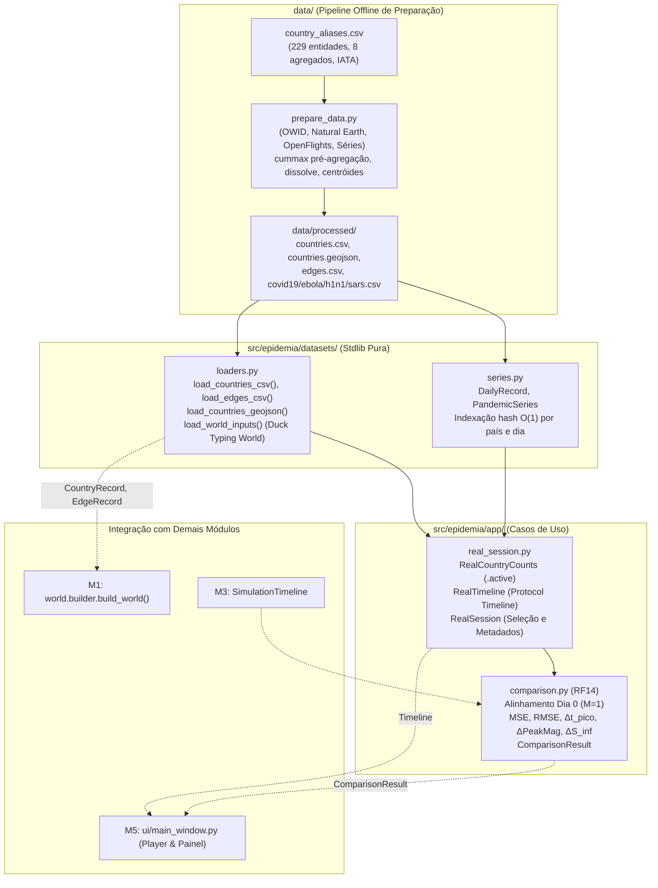

# Relatório Técnico de Implementação — Módulo 4 (Dados e Comparação com a Realidade)

Este documento consolida toda a engenharia de dados, normalização geográfica, fundamentação
matemática de métricas epidemiológicas, análise de complexidade assintótica e validação por testes
automatizados do **Módulo 4 (Responsável D)** do **Simulador de Epidemias em Redes**.

As tabelas de complexidade, equações e discussão de limitações deste relatório estão prontas
para inclusão direta no **artigo científico no formato SBC (LaTeX)** e no **roteiro de apresentação em vídeo**.

---

## 1. Resumo Executivo e Rastreabilidade de Requisitos

O Módulo 4 foi implementado em estrita conformidade com as regras de isolamento de camadas
do projeto. O pacote em tempo de execução (`src/epidemia/datasets/`) utiliza **exclusivamente a
biblioteca padrão do Python** (`csv`, `json`, `dataclasses`, `pathlib`), sem nenhuma dependência
de `pandas`, `shapely`, `networkx` ou `PySide6`, conforme verificado por `test_camadas.py`.

| Requisito / Decisão | Descrição Oficial | Arquivo(s) Implementado(s) | Status |
|---|---|---|---|
| **RF09** | Seleção entre as 4 pandemias históricas (COVID-19, Ebola, H1N1, SARS) | `app/real_session.py`, `datasets/series.py` | Concluído |
| **RF10 / RF13** | Grafo global unificado de 229 entidades e fornecimento de geometrias e rotas | `datasets/loaders.py`, `data/prepare_data.py` | Concluído |
| **RF11 / RF12** | Reprodução temporal das pandemias reais via contrato unificado `Timeline` | `app/real_session.py` (`RealTimeline`) | Concluído |
| **RF14** | Comparação quantitativa entre curva simulada e dados reais (MSE/RMSE, pico, tamanho final) | `app/comparison.py` (`compare_simulation_to_real`) | Concluído |
| **RNF10** | Dados pré-processados: o aplicativo lê apenas `data/processed/` em tempo de execução | `datasets/loaders.py`, `datasets/series.py` | Concluído |
| **D8 / D9 / D19 / D24** | Universo fixo de **229 entidades**: descarte de não-países, agregação dos 8 territórios, Kosovo (`KOS`) e Norte do Chipre somado ao Chipre | `data/country_aliases.csv`, `data/prepare_data.py` | Concluído |
| **D10 / D11 / D12 / D21** | Grade diária contínua, `cummax` antes de somar territórios agregados e recuperados apenas no SARS | `data/prepare_data.py`, `datasets/series.py` | Concluído |
| **D13 / D14 / D16** | Número bruto de rotas em `edges.csv` ($A < B$), exclusão de codeshare ($=Y$) e países isolados sem arestas artificiais | `data/prepare_data.py`, `datasets/loaders.py` | Concluído |
| **D20 / D15** | Geometria `countries.geojson` (Natural Earth 50m): chave `ISO_A3_EH` (fallback `ADM0_A3`), centróide com correção do antimeridiano ($\pm 180^\circ$) | `data/prepare_data.py`, `datasets/loaders.py` | Concluído |
| **D22 / D23** | Resolução histórica da Libéria no Ebola (descarte da série *Liberia 2*) e China no SARS (manter 1.309 casos em 12/04/2003) | `data/prepare_data.py` | Concluído |
| **D25** | Repositório público com dados derivados sob licença ODbL 1.0 e README com atribuições | `data/README.md`, `data/LICENSE-ODbL.txt` | Concluído |

---

## 2. Arquitetura Implementada e Interação entre Componentes

---

## 3. Detalhamento Técnico e Matemático por Arquivo

### 3.1. Pipeline Offline de Preparação (`data/`)

#### 1. `data/country_aliases.csv`
Tabela com 135 entradas mapeando variações de grafia, códigos históricos e exceções:
* **Exclusão de não-países (`DROP`, Decisão D8):** Navios de cruzeiro (*Diamond Princess*, *MS Zaandam*), eventos esportivos (*Summer/Winter Olympics*), e feições geográficas sem população/soberania no modelo (*ATA, ATF, HMD, NFK, SGS, IOT, SOL, KAS*).
* **Agregação dos 8 territórios sem polígono próprio (Decisão D9):**
  - Gibraltar (`GIB` $\to$ `GBR`);
  - Bonaire, Santo Eustáquio e Saba (`BES` $\to$ `NLD`);
  - Tokelau (`TKL` $\to$ `NZL`);
  - Guadalupe (`GLP`), Guiana Francesa (`GUF`), Martinica (`MTQ`), Mayotte (`MYT`), Reunião (`REU`) $\to$ `FRA`.
* **Exceções territoriais e de aeroportos (OpenFlights):**
  - Aeroporto de Pristina (`iata:PRN` $\to$ `KOS`, Kosovo, Decisão D19);
  - Aeroportos das Antilhas Holandesas (`iata:BON`, `iata:EUX`, `iata:SAB` $\to$ `BES`/`NLD`; `iata:CUR` $\to$ `CUW`; `iata:SXM` $\to$ `SXM`);
  - Norte do Chipre (`OWID_CYN`/`CYN` $\to$ `CYP`, Chipre, somando 382.836 hab, Decisão D24);
  - Ilhas Åland (`ALA` $\to$ `FIN`, Finlândia).

#### 2. `data/prepare_data.py`
Script CLI de execução única (`python data/prepare_data.py --raw <pasta> --out data/processed`):
* **Universo Exato de 229 Entidades:**
  $$237 \text{ (OWID com continente)} - 8 \text{ (territórios D9)} - 1 \text{ (OWID\_CYN D24)} + 1 \text{ (Kosovo D19)} = 229 \text{ entidades}$$
* **Geometria e Centróides com Tratamento de Antimeridiano (Decisões D15, D20):**
  Para países cujas fronteiras cruzam o meridiano $180^\circ$ (Rússia, Fiji, EUA, Kiribati e Nova Zelândia), o cálculo ingênuo do centróide cartesiano geraria coordenadas distorcidas no meio do Oceano Atlântico/África. O script calcula a média das partes ponderada por área deslocando as longitudes negativas em $+360^\circ$ antes de determinar o ponto médio.
* **Malha Aérea e Arestas Internacionais (Decisões D13, D14, D16):**
  Filtra rotas com `codeshare == 'Y'` para não inflacionar frequências de voo compartilhadas, descarta conexões domésticas (incluindo rotas entre território ultramarino e metrópole) e soma pares não direcionados $A < B$.
* **Ordem de Agregação das Séries e Cummax (Decisão D21):**
  Aplica a grade diária contínua e a função não decrescente $\text{cummax}(t)$ em cada território de origem **antes** de somar no país-mãe, evitando distorções quando território e metrópole reportam em frequências distintas.
* **Resolução Histórica da Libéria (D22) e China (D23):**
  - Na Libéria (Ebola), seleciona por data o registro de maior número de casos, descartando a série *Liberia 2*.
  - Na China (SARS), em 12/04/2003, mantém o valor contínuo crescente de 1.309 casos e descarta o valor anômalo de 62 casos.

---

### 3.2. Camada de Dados em Tempo de Execução (`src/epidemia/datasets/`)

#### 3. `src/epidemia/datasets/loaders.py`
* **`CountryRecord` e `EdgeRecord`:** Dataclasses leves com `slots=True`, sem overhead de objetos mutáveis.
* **`load_world_inputs()`:** Utilitário desacoplado que carrega `countries.csv`, `edges.csv` e `countries.geojson` e entrega instâncias compatíveis por *duck typing* diretamente com o construtor `world.builder.build_world()`, permitindo que o M1 construa o grafo real sem importar código de domínio em `datasets/`.

#### 4. `src/epidemia/datasets/series.py`
* **`DailyRecord` e `PandemicSeries`:**
  - Indexa a série temporal em tuplas imutáveis e tabelas hash bidimensionais `(iso3, day_idx) -> DailyRecord` e `(iso3, date_str) -> DailyRecord`.
  - Consultas diárias do player e dos gráficos ocorrem em tempo estritamente constante $O(1)$.
  - Trata com segurança o compartimento de recuperados ($R$), que é preenchido no SARS e `None` nas demais pandemias.

---

### 3.3. Camada de Aplicação do Fluxo Real e Comparação Científica (`src/epidemia/app/`)

#### 5. `src/epidemia/app/real_session.py`
* **`RealTimeline`:**
  - Cumpre o contrato `@runtime_checkable class Timeline(Protocol)`.
  - `vertex_states(day)` devolve `None` (no fluxo real os vértices não possuem estados estocásticos individuais, herdando a cor do polígono na interface).
  - `country_counts(day)` entrega instâncias de `RealCountryCounts` (com propriedade `.active` compatível com `app/panel_metrics.py`).
  - `country_day_zero()`: localiza o dia em que o total de casos atinge o limiar proporcional a $M=1$ vértice:
    $$\text{TargetCases}_i = \max\left(1, \text{round}\left(M \cdot \frac{\text{Pop}_i}{N_{\text{total}}}\right)\right)$$
* **`RealSession`:** Fachada de aplicação consumida pela interface gráfica para listar pandemias, carregar séries e fornecer metadados globais.

#### 6. `src/epidemia/app/comparison.py` (Requisito RF14)
Implementa a comparação científica entre o modelo estocástico SEIRD e a série real:
1. **Alinhamento pelo Dia 0:**
   Determina $t_0^{\text{sim}}$ e $t_0^{\text{real}}$ e extrai o intervalo de sobreposição comum $T_{\text{comum}} = \min(T_{\text{sim}} - t_0^{\text{sim}}, T_{\text{real}} - t_0^{\text{real}})$.
2. **Normalização por Fração Populacional:**
   $$y_{\text{sim}}(k) = \frac{C_{\text{sim}}(t_0^{\text{sim}} + k)}{N_{\text{sim}}}, \quad y_{\text{real}}(k) = \frac{C_{\text{real}}(t_0^{\text{real}} + k)}{\text{Pop}_{\text{real}}}$$
   onde $C_{\text{sim}} = I + R_{\text{natural}} + D$ (exclui expostos e vacinados).
3. **Métricas de Erro e Dinâmica do Surto:**
   - **MSE e RMSE de Casos e Óbitos:**
     $$\text{MSE} = \frac{1}{T_{\text{comum}}} \sum_{k=0}^{T_{\text{comum}}-1} \left(y_{\text{sim}}(k) - y_{\text{real}}(k)\right)^2, \quad \text{RMSE} = \sqrt{\text{MSE}}$$
   - **Diferença no Dia de Pico ($\Delta t_{\text{pico}}$):**
     $$\Delta t_{\text{pico}} = k_{\text{pico, sim}} - k_{\text{pico, real}}$$
     onde $k_{\text{pico}} = \operatorname{argmax}_k \Delta C(k)$ sobre a série de novos casos diários.
   - **Diferença no Tamanho Final ($\Delta S_\infty$):**
     $$\Delta S_\infty = y_{\text{sim}}(T_{\text{comum}}-1) - y_{\text{real}}(T_{\text{comum}}-1)$$
4. **`ComparisonResult`:** Estrutura imutável com métodos `formatted_summary()` (para exibição compacta no painel do M5) e `detailed_report()` (relatório textual completo).

---

## 4. Tabela de Complexidade Assintótica (Pronta para o Relatório SBC)

| Componente / Algoritmo | Arquivo | Complexidade de Tempo | Complexidade de Espaço | Justificativa Técnica |
|---|---|---|---|---|
| **Pipeline ETL (`prepare_data.py`)** | `data/prepare_data.py` | $O(N \log N)$ | $O(N)$ | Leitura, ordenação e união poligonal offline (executado uma única vez) |
| **Leitura de Países (`load_countries_csv`)** | `datasets/loaders.py` | $O(M)$ | $O(M)$ | Varredura linear do CSV com $M=229$ entidades |
| **Leitura de Arestas (`load_edges_csv`)** | `datasets/loaders.py` | $O(E_{\text{aéreo}})$ | $O(E_{\text{aéreo}})$ | Leitura linear de $\approx 2.200$ rotas consolidadas |
| **Leitura de Séries (`load_pandemic_series`)** | `datasets/series.py` | $O(T \cdot M)$ | $O(T \cdot M)$ | Indexação hash direta para acesso $O(1)$ por dia |
| **Consulta Diária (`RealTimeline.country_counts`)** | `app/real_session.py` | $O(M)$ (1ª vez) / $O(1)$ (cache) | $O(M)$ por dia | Criação de $M=229$ instâncias de `RealCountryCounts` com memoização |
| **Cálculo de Dia 0 (`country_day_zero`)** | `app/real_session.py` | $O(T)$ | $O(1)$ | Busca linear ao longo dos $T$ dias do surto até o limiar |
| **Comparação Simulado × Real (`compare_simulation_to_real`)** | `app/comparison.py` | $O(T_{\text{comum}})$ | $O(T_{\text{comum}})$ | Uma passada linear sobre as trajetórias alinhadas ($T_{\text{comum}} \le 1.100$ dias) |

---

## 5. Limitações Estruturais e Metodológicas (Para o Artigo SBC)

1. **Malha Aérea Estática de 2014:**
   As rotas do OpenFlights foram congeladas em junho de 2014. Trata-se de um retrato estático aplicado retrospectivamente às 4 pandemias (SARS 2003, H1N1 2009, Ebola 2014–2016 e COVID-19 2020–2022).
2. **População Fixa de Referência (2022):**
   Os dados demográficos do OWID refletem os censos de 2022, sendo utilizados como denominadores de escala mesmo para os surtos de 2003 e 2009.
3. **Países Isolados na Malha Aérea:**
   Países sem registros de voos comerciais internacionais no OpenFlights (Andorra, Mônaco, Vaticano, San Marino, etc.) permanecem desconexos na rede de transporte aéreo internacional (Decisão D16), sem fabricação de arestas artificiais.
4. **Ausência de Casos Ativos e Recuperados na Fonte:**
   COVID-19, Ebola e H1N1 não possuem dados confiáveis de recuperados ao longo de todo o período, impossibilitando isolar casos ativos clínicos reais sem inferências de modelos auxiliares.
5. **Subnotificação Não Modelada:**
   As séries históricas refletem apenas casos notificados e confirmados pelos sistemas de vigilância epidemiológica, sem correção de subnotificação assintomática.

---

## 6. Validação e Cobertura de Testes Automatizados

Toda a implementação do Módulo 4 foi validada com **21 testes unitários automatizados dedicados**:
* `tests/datasets/test_loaders.py` (**8 testes**): Validação de CSVs, colunas ausentes, auto-laços, valores negativos e vinculação de geometrias;
* `tests/datasets/test_series.py` (**6 testes**): Validação das 4 séries pandêmicas, indexação hash $O(1)$, busca por dia/data e totais diários;
* `tests/app/test_real_session.py` (**4 testes**): Cumprimento formal do protocolo `Timeline`, geração de `RealCountryCounts`, Dia 0 e ciclo de vida da `RealSession`;
* `tests/app/test_comparison.py` (**3 testes**): Validação matemática das métricas de MSE, $\Delta t_{\text{pico}}$, tamanho final e relatórios textuais.
