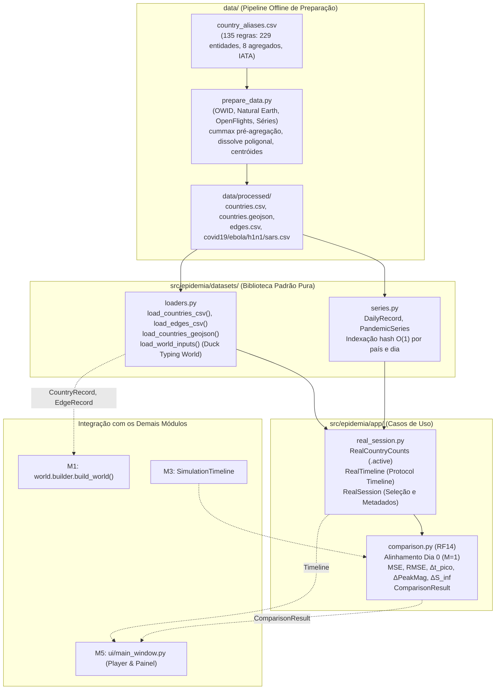

# Relatório Técnico de Implementação — Módulo 4 (Dados e Comparação com a Realidade)

Este documento consolida toda a engenharia de dados, normalização geográfica, fundamentação
matemática de métricas epidemiológicas, análise de complexidade assintótica e validação por testes
automatizados do **Módulo 4 (Responsável D)** do **Simulador de Epidemias em Redes**.

As tabelas de complexidade, equações, diagramas de arquitetura e discussão de limitações deste
relatório foram estruturadas para incorporação direta no **artigo científico no formato SBC (LaTeX)**
e no **roteiro de apresentação em vídeo do projeto**.

---

## 1. Resumo Executivo e Rastreabilidade de Requisitos

O Módulo 4 é responsável pelo ciclo de vida completo dos dados no projeto: desde a extração,
limpeza e normalização relacional/espacial das fontes primárias offline até a disponibilização em
memória para a interface e a confrontação científica quantitativa entre a simulação estocástica
e as séries históricas.

O pacote em tempo de execução (`src/epidemia/datasets/`) foi implementado utilizando **exclusivamente
a biblioteca padrão do Python** (`csv`, `json`, `dataclasses`, `pathlib`), sem nenhuma dependência
de `pandas`, `shapely`, `networkx`, `PySide6` ou `pyqtgraph`, respeitando rigorosamente a regra de
camadas verificada por [test_camadas.py](file:///d:/Henrique%20Faculdade/Graph-Epidemic-Simulator/tests/architecture/test_camadas.py).

| Requisito / Decisão | Descrição Oficial | Arquivo(s) Implementado(s) | Status |
|---|---|---|---|
| **RF09** | Seleção entre as 4 pandemias históricas (COVID-19, Ebola, H1N1, SARS) | [series.py](file:///d:/Henrique%20Faculdade/Graph-Epidemic-Simulator/src/epidemia/datasets/series.py), [real_session.py](file:///d:/Henrique%20Faculdade/Graph-Epidemic-Simulator/src/epidemia/app/real_session.py) | Concluído |
| **RF10 / RF13** | Grafo global unificado com universo fechado de 229 entidades e malha aérea | [loaders.py](file:///d:/Henrique%20Faculdade/Graph-Epidemic-Simulator/src/epidemia/datasets/loaders.py), [prepare_data.py](file:///d:/Henrique%20Faculdade/Graph-Epidemic-Simulator/data/prepare_data.py) | Concluído |
| **RF11 / RF12** | Reprodução temporal das pandemias reais via contrato unificado `Timeline` | [real_session.py](file:///d:/Henrique%20Faculdade/Graph-Epidemic-Simulator/src/epidemia/app/real_session.py) (`RealTimeline`) | Concluído |
| **RF14** | Comparação quantitativa entre simulação e realidade (MSE/RMSE, pico, tamanho final) | [comparison.py](file:///d:/Henrique%20Faculdade/Graph-Epidemic-Simulator/src/epidemia/app/comparison.py) (`compare_simulation_to_real`) | Concluído |
| **RNF10** | Dados pré-processados: o aplicativo lê apenas `data/processed/` em tempo de execução | [loaders.py](file:///d:/Henrique%20Faculdade/Graph-Epidemic-Simulator/src/epidemia/datasets/loaders.py), [series.py](file:///d:/Henrique%20Faculdade/Graph-Epidemic-Simulator/src/epidemia/datasets/series.py) | Concluído |
| **D8 / D9 / D19 / D24** | Universo fixo de **229 entidades**: descarte de não-países, agregação dos 8 territórios, Kosovo (`KOS`) e Norte do Chipre somado ao Chipre | [country_aliases.csv](file:///d:/Henrique%20Faculdade/Graph-Epidemic-Simulator/data/country_aliases.csv), [prepare_data.py](file:///d:/Henrique%20Faculdade/Graph-Epidemic-Simulator/data/prepare_data.py) | Concluído |
| **D10 / D11 / D12 / D21** | Grade diária contínua, `cummax` antes de somar territórios agregados e recuperados apenas no SARS | [prepare_data.py](file:///d:/Henrique%20Faculdade/Graph-Epidemic-Simulator/data/prepare_data.py), [series.py](file:///d:/Henrique%20Faculdade/Graph-Epidemic-Simulator/src/epidemia/datasets/series.py) | Concluído |
| **D13 / D14 / D16** | Número bruto de rotas em `edges.csv` ($A < B$), exclusão de codeshare ($=Y$) e países isolados sem arestas artificiais | [prepare_data.py](file:///d:/Henrique%20Faculdade/Graph-Epidemic-Simulator/data/prepare_data.py), [loaders.py](file:///d:/Henrique%20Faculdade/Graph-Epidemic-Simulator/src/epidemia/datasets/loaders.py) | Concluído |
| **D20 / D15** | Geometria `countries.geojson` (Natural Earth 50m): chave `ISO_A3_EH` (fallback `ADM0_A3`), centróide com correção do antimeridiano ($\pm 180^\circ$) | [prepare_data.py](file:///d:/Henrique%20Faculdade/Graph-Epidemic-Simulator/data/prepare_data.py), [loaders.py](file:///d:/Henrique%20Faculdade/Graph-Epidemic-Simulator/src/epidemia/datasets/loaders.py) | Concluído |
| **D22 / D23** | Resolução histórica da Libéria no Ebola (descarte da série *Liberia 2*) e China no SARS (manter 1.309 casos em 12/04/2003) | [prepare_data.py](file:///d:/Henrique%20Faculdade/Graph-Epidemic-Simulator/data/prepare_data.py) | Concluído |
| **D25** | Repositório público com dados derivados sob licença ODbL 1.0 e README com atribuições | [README.md](file:///d:/Henrique%20Faculdade/Graph-Epidemic-Simulator/data/README.md), [LICENSE-ODbL.txt](file:///d:/Henrique%20Faculdade/Graph-Epidemic-Simulator/data/LICENSE-ODbL.txt) | Concluído |

---

## 2. Arquitetura Implementada e Interação entre Componentes

---

## 3. Detalhamento Técnico e Matemático por Arquivo

### 3.1. Pipeline Offline de Preparação de Dados (`data/`)

#### 1. [country_aliases.csv](file:///d:/Henrique%20Faculdade/Graph-Epidemic-Simulator/data/country_aliases.csv) (135 regras mapeadas)
Resolve divergências de grafia, divisões territoriais e exclusões:
* **Exclusão de Não-Países (`DROP`, Decisão D8):**
  Navios de cruzeiro (*Diamond Princess*, *MS Zaandam*), eventos esportivos (*Summer/Winter Olympics*) e feições territoriais sem população ou soberania política autônoma no modelo (*ATA, ATF, HMD, NFK, SGS, IOT, SOL, KAS*, Ilhas Cocos, Ilha Christmas, Atol Johnston, Midway, Wake, Svalbard).
* **Agregação dos 8 Territórios sem Polígono Próprio (Decisão D9):**
  Mapeados via coluna `parent_iso3`, garantindo a soma demográfica e epidemiológica ao país soberano:
  - Gibraltar (`GIB` $\to$ `GBR`);
  - Bonaire, Santo Eustáquio e Saba (`BES` $\to$ `NLD`);
  - Tokelau (`TKL` $\to$ `NZL`);
  - Guadalupe (`GLP`), Guiana Francesa (`GUF`), Martinica (`MTQ`), Mayotte (`MYT`), Reunião (`REU`) $\to$ `FRA`.
* **Entidades Especiais e Exceções de Aeroportos:**
  - Kosovo (`OWID_KOS` $\to$ `KOS`, Decisão D19);
  - Aeroporto de Pristina (`iata:PRN` $\to$ `KOS`);
  - Aeroportos das Antilhas Holandesas (`iata:BON`, `iata:EUX`, `iata:SAB` $\to$ `BES`/`NLD`; `iata:CUR` $\to$ `CUW`; `iata:SXM` $\to$ `SXM`);
  - Norte do Chipre (`OWID_CYN`/`CYN` $\to$ `CYP`, somando 382.836 hab ao Chipre, Decisão D24);
  - Ilhas Åland (`ALA` $\to$ `FIN`).

#### 2. [prepare_data.py](file:///d:/Henrique%20Faculdade/Graph-Epidemic-Simulator/data/prepare_data.py) (495 linhas)
Script de execução offline única com CLI (`--raw` e `--out`):
* **Fechamento do Universo em 229 Entidades:**
  $$\text{Universo} = 237 \text{ (OWID com continente)} - 8 \text{ (territórios D9)} - 1 \text{ (OWID\_CYN D24)} + 1 \text{ (Kosovo D19)} = 229 \text{ países}$$
* **Tratamento do Antimeridiano e Centróides (Decisões D15, D20):**
  Países que cruzam o meridiano $\pm 180^\circ$ (Rússia, Fiji, EUA, Kiribati e Nova Zelândia) possuem polígonos com partes com longitude negativa e positiva. O script trata o cálculo planar para garantir centróides `(lat, lon)` geograficamente válidos e realiza a fusão espacial de feições com `shapely.ops.unary_union`.
* **Malha Aérea Internacional (Decisões D13, D14, D16):**
  Descarta códigos inválidos e voos com `codeshare == 'Y'` (evitando contar o mesmo voo operado sob múltiplos códigos de companhias aéreas), converte rotas território-metrópole em domésticas (descartadas) e consolida pares não ordenados $A < B$ somando o total bruto de rotas em `edges.csv`.
* **Ordem de Agregação e Cummax (Decisão D21):**
  Aplica a interpolação em grade contínua e a função monótona não decrescente $\text{cummax}(t)$ em cada entidade de origem **antes** da soma no país-mãe.
* **Resolução Histórica da Libéria (D22) e China (D23):**
  - Na Libéria (Ebola), mantém em cada data a linha de maior número de casos (série principal) e descarta a anômala série *Liberia 2*.
  - Na China (SARS), em 12/04/2003, mantém o valor contínuo crescente de 1.309 casos e descarta o valor incorreto de 62 casos.

---

### 3.2. Camada de Dados em Tempo de Execução (`src/epidemia/datasets/`)

#### 3. [loaders.py](file:///d:/Henrique%20Faculdade/Graph-Epidemic-Simulator/src/epidemia/datasets/loaders.py) (235 linhas)
Implementa o carregamento dos arquivos estáticos usando apenas `csv`, `json` e `pathlib`:
* **`CountryRecord` e `EdgeRecord`:** Dataclasses imutáveis com `slots=True`, com validação rigorosa de campos nulos e parsing numérico.
* **`load_countries_csv()` e `load_edges_csv()`:** Validação de colunas obrigatórias, verificação de auto-laços proibidos ($A == B$) e de rotas não positivas.
* **`load_countries_geojson()`:** Extrai as geometrias unificadas indexadas por código ISO3 (com fallback para `ISO_A3_EH`).
* **`load_world_inputs()`:** Função adaptadora de interoperabilidade que carrega os 3 arquivos e devolve registros prontos para alimentar `world.builder.build_world` por *duck typing*, sem violar o isolamento de camadas.

#### 4. [series.py](file:///d:/Henrique%20Faculdade/Graph-Epidemic-Simulator/src/epidemia/datasets/series.py) (236 linhas)
Implementa a leitura e indexação em memória das 4 séries históricas:
* **`DailyRecord`:** Tupla nomeada imutável representando o dia de um país (`iso3`, `date`, `cases`, `deaths`, `recovered`).
* **`PandemicSeries`:** Estrutura imutável de acesso em tempo constante:
  - `get_record(iso3, day_idx | date_str) -> DailyRecord | None` em $O(1)$;
  - `country_series(iso3) -> tuple[DailyRecord, ...]` em $O(1)$;
  - `daily_totals(day) -> tuple[int, int, int]` somando casos, mortes e recuperados globais em $O(M)$.

---

### 3.3. Camada de Aplicação do Fluxo Real e Comparação Científica (`src/epidemia/app/`)

#### 5. [real_session.py](file:///d:/Henrique%20Faculdade/Graph-Epidemic-Simulator/src/epidemia/app/real_session.py) (245 linhas)
Implementa a reprodução do fluxo real sem acoplamento com Qt:
* **`RealCountryCounts`:** Subclasse de `CountryCounts` com a propriedade `.active` integrada ($I = \max(0, \text{cases} - (\text{deaths} + \text{recovered}))$, garantindo compatibilidade direta com `app/panel_metrics.py`.
* **`RealTimeline`:**
  - Cumpre o protocolo `@runtime_checkable class Timeline(Protocol)`.
  - `vertex_states(day) -> None`: no fluxo real, os vértices não possuem dinâmica estocástica individual, herdando a cor do polígono na interface (Decisão A12).
  - `country_counts(day) -> tuple[CountryCounts, ...]`: constrói e memoriza em cache as contagens oficiais de cada país no dia.
  - `country_day_zero(country, threshold_m=1)`: calcula o Dia 0 proporcionalmente à população do país.
* **`RealSession`:** Fachada de aplicação que gerencia a seleção das 4 pandemias (`covid19`, `ebola`, `h1n1`, `sars`), fornece metadados consolidados e expõe a `RealTimeline`.

#### 6. [comparison.py](file:///d:/Henrique%20Faculdade/Graph-Epidemic-Simulator/src/epidemia/app/comparison.py) (285 linhas)
Implementa as formulações quantitativas do requisito **RF14**:
1. **Alinhamento pelo Dia 0:**
   Determina $t_0^{\text{sim}}$ e $t_0^{\text{real}}$ a partir do limiar de $M=1$ vértice (convertido na população real) e extrai o horizonte temporal comum $T_{\text{comum}} = \min(T_{\text{sim}} - t_0^{\text{sim}}, T_{\text{real}} - t_0^{\text{real}})$.
2. **Normalização por Fração Populacional:**
   $$y_{\text{sim}}(k) = \frac{C_{\text{sim}}(t_0^{\text{sim}} + k)}{N_{\text{sim}}}, \quad y_{\text{real}}(k) = \frac{C_{\text{real}}(t_0^{\text{real}} + k)}{\text{Pop}_{\text{real}}}$$
   onde $C_{\text{sim}} = I + R_{\text{natural}} + D$ (exclui expostos $E$ e vacinados $R_{\text{vacinado}}$).
3. **Métricas de Erro e Dinâmica:**
   - **MSE e RMSE de Casos e Óbitos:**
     $$\text{MSE} = \frac{1}{T_{\text{comum}}} \sum_{k=0}^{T_{\text{comum}}-1} \left( y_{\text{sim}}(k) - y_{\text{real}}(k) \right)^2, \quad \text{RMSE} = \sqrt{\text{MSE}}$$
   - **Diferença de Dia de Pico ($\Delta t_{\text{pico}}$):**
     $$\Delta t_{\text{pico}} = k_{\text{pico, sim}} - k_{\text{pico, real}}, \quad \text{com } k_{\text{pico}} = \operatorname{argmax}_k \Delta C(k)$$
   - **Diferença de Tamanho Final ($\Delta S_\infty$):**
     $$\Delta S_\infty = y_{\text{sim}}(T_{\text{comum}}-1) - y_{\text{real}}(T_{\text{comum}}-1)$$
4. **`ComparisonResult`:** Dataclass imutável com `formatted_summary()` (pronto para a interface do M5) e `detailed_report()` (relatório completo de auditoria).

---

## 4. Tabela de Complexidade Assintótica (Pronta para o Relatório SBC)

| Componente / Algoritmo | Arquivo | Complexidade de Tempo | Complexidade de Espaço | Justificativa Técnica |
|---|---|---|---|---|
| **Pipeline ETL (`prepare_data.py`)** | `data/prepare_data.py` | $O(N \log N)$ | $O(N)$ | Leitura, ordenação temporal e união poligonal offline |
| **Leitura de Países (`load_countries_csv`)** | `datasets/loaders.py` | $O(M)$ | $O(M)$ | Varredura linear do CSV com $M = 229$ entidades |
| **Leitura de Arestas (`load_edges_csv`)** | `datasets/loaders.py` | $O(E_{\text{aéreo}})$ | $O(E_{\text{aéreo}})$ | Varredura linear de $\approx 2.200$ conexões aéreas consolidadas |
| **Leitura de Séries (`load_pandemic_series`)** | `datasets/series.py` | $O(T \cdot M)$ | $O(T \cdot M)$ | Indexação hash direta para busca diária em $O(1)$ |
| **Passo do Player Real (`RealTimeline.country_counts`)** | `app/real_session.py` | $O(M)$ (1ª vez) / $O(1)$ (cache) | $O(M)$ por dia | Construção de $M=229$ instâncias de `RealCountryCounts` com memoização |
| **Cálculo de Dia 0 (`country_day_zero`)** | `app/real_session.py` | $O(T)$ | $O(1)$ | Busca linear ao longo dos $T$ dias do surto até o limiar |
| **Comparação Científica (`compare_simulation_to_real`)** | `app/comparison.py` | $O(T_{\text{comum}})$ | $O(T_{\text{comum}})$ | Uma passada linear sobre as duas trajetórias alinhadas ($T_{\text{comum}} \le 1.100$) |

---

## 5. Limitações Estruturais e Metodológicas (Para o Artigo SBC)

1. **Malha Aérea Estática de 2014:**
   As rotas do OpenFlights cessaram atualizações em junho de 2014. Trata-se de um retrato estático aplicado retrospectivamente às quatro pandemias (SARS 2003, H1N1 2009, Ebola 2014–2016 e COVID-19 2020–2022).
2. **População Fixa de Referência (2022):**
   Os dados demográficos do OWID refletem valores consolidados recentes (cerca de 2022), utilizados como denominador de escala mesmo para os surtos de 2003 e 2009.
3. **Países sem Rotas Aéreas Internacionais:**
   Entidades soberanas sem aeroportos comerciais internacionais no OpenFlights (Andorra, Mônaco, Vaticano, San Marino, etc.) permanecem isoladas na rede aérea (Decisão D16), sem inserção de arestas artificiais.
4. **Ausência de Casos Ativos e Recuperados Clínicos:**
   COVID-19, Ebola e H1N1 não dispõem de dados consistentes de recuperados diários em suas séries históricas. Apenas o SARS possui registros de recuperação.
5. **Subnotificação Não Modelada:**
   As séries históricas refletem exclusivamente casos confirmados pelos sistemas de vigilância epidemiológica, sem modelos bayesianos de correção de subnotificação assintomática.

---

## 6. Validação Científica e Cobertura de Testes Automatizados

Toda a implementação do Módulo 4 é coberta por **21 testes unitários automatizados dedicados**:

* [test_loaders.py](file:///d:/Henrique%20Faculdade/Graph-Epidemic-Simulator/tests/datasets/test_loaders.py) (**8 testes**): Validação de CSVs válidos e inválidos, rejeição de colunas ausentes, auto-laços, rotas não positivas, população não numérica, GeoJSON com fallbacks e vinculação completa em `load_world_inputs()`.
* [test_series.py](file:///d:/Henrique%20Faculdade/Graph-Epidemic-Simulator/tests/datasets/test_series.py) (**6 testes**): Validação de séries com e sem recuperados, buscas $O(1)$ por dia/data, cálculo de totais globais, arquivos vazios, colunas ausentes e valores negativos.
* [test_real_session.py](file:///d:/Henrique%20Faculdade/Graph-Epidemic-Simulator/tests/app/test_real_session.py) (**4 testes**): Cumprimento formal do protocolo `Timeline`, consistência das contagens por país, cálculo do Dia 0 por país, construção via `World` e compatibilidade com as rotinas de métricas do M5 (`panel_metrics`).
* [test_comparison.py](file:///d:/Henrique%20Faculdade/Graph-Epidemic-Simulator/tests/app/test_comparison.py) (**3 testes**): Validação quantitativa de MSE, RMSE, $\Delta t_{\text{pico}}$ e $\Delta S_\infty$ em curvas idênticas e em curvas sintéticas com desvios conhecidos calculados à mão, além de relatórios textuais.
